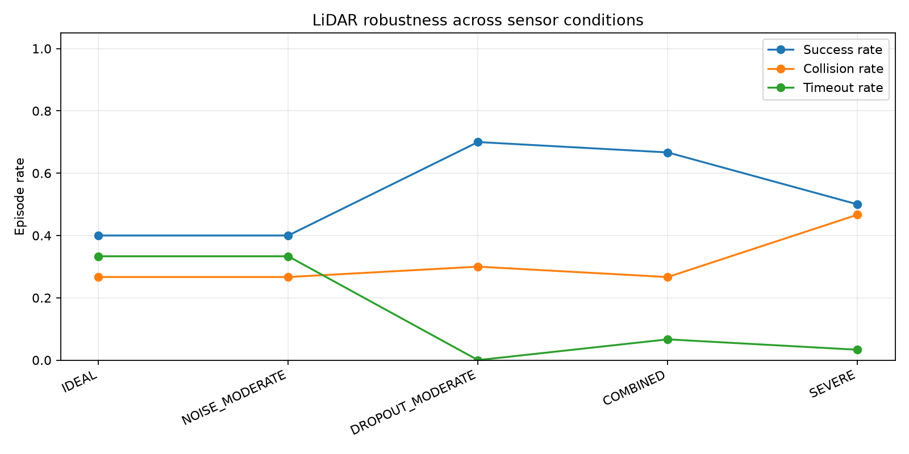

# LiDAR Robustness Benchmark

## Overview

The LiDAR robustness benchmark evaluates a fixed drone-navigation policy
across five sensor conditions. The benchmark varies LiDAR measurement
noise, beam dropout, and minimum sensing range without retraining the
policy.

The implementation is in
`src/adaptive_rl/benchmarking/lidar_benchmark.py`.

## Sensor conditions

| Condition | Noise std (m) | Dropout probability | Blind range (m) |
|---|---:|---:|---:|
| LIDAR_IDEAL | 0.00 | 0.00 | 0.0 |
| LIDAR_NOISE_MODERATE | 0.15 | 0.00 | 0.0 |
| LIDAR_DROPOUT_MODERATE | 0.00 | 0.20 | 0.0 |
| LIDAR_COMBINED | 0.15 | 0.20 | 0.0 |
| LIDAR_SEVERE | 0.35 | 0.40 | 0.5 |

## Evaluation protocol

The default evaluation uses 30 episodes per condition, with identical
episode reset seeds across conditions. Deterministic policy actions
are used, and the same model checkpoint is evaluated throughout.

Matched seeds preserve the starting scenario and obstacle geometry.
Sensor perturbations differ according to the condition being tested.

The benchmark reports:

- Success, collision, and timeout rates
- Mean minimum obstacle clearance
- Mean trajectory path length
- Mean cumulative episode reward
- Per-episode collision types and failure classifications

## Usage

Train a nominal PPO policy:

```powershell
adaptive-rl train --config configs/drone_ppo.yaml --timesteps 50000
adaptive-rl benchmark lidar --model artifacts/models/drone_ppo_final.zip --episodes 30 --seed 1000
```

The default output directory is `artifacts/benchmarks/`.

Generated files:

- `lidar_robustness.json`: metadata, summaries, and episode results
- `lidar_robustness.csv`: condition-level metrics
- `lidar_robustness_episodes.csv`: episode-level outcomes
- `lidar_robustness.png`: robustness visualization

## Failure classification

Obstacle collisions are classified as `near_obstacle_collision`.
Boundary collisions are classified as `boundary_collision`.
Other collisions retain the `other_collision` label.

Timeout classification uses the final 20 simulation steps:

- `freeze_timeout`: total path length below 0.5 m
- `oscillation_timeout`: path length at least 2.0 m and net displacement below 1.0 m
- `unclassified_timeout`: insufficient trajectory data or movement outside these definitions

These classifications describe observed movement patterns, not their underlying causes.

## Example experiment

A PPO policy trained for 50,000 timesteps with training seed 42
was evaluated using 30 matched evaluation seeds, 1000 through 1029.

| Condition | Success | Collision | Timeout |
|---|---:|---:|---:|
| Ideal | 40.0% | 26.7% | 33.3% |
| Moderate noise | 40.0% | 26.7% | 33.3% |
| Moderate dropout | 70.0% | 30.0% | 0.0% |
| Combined | 66.7% | 26.7% | 6.7% |
| Severe | 50.0% | 46.7% | 3.3% |



Severe degradation increased the observed collision rate by 20 percentage
points relative to ideal sensing. In paired comparisons, severe degradation
introduced seven collisions and avoided one collision.

Seven boundary collisions occurred under severe degradation, compared
with none under ideal sensing.

The results do not demonstrate monotonic degradation. Moderate dropout
and combined perturbations produced higher success rates than ideal
sensing. Minimum obstacle clearance was also non-monotonic.

These findings describe one trained PPO policy and 30 evaluation scenarios
per condition. They do not establish statistical significance or
generalization across training seeds. The 40% success rate under ideal
sensing also limits the interpretation of robustness.
