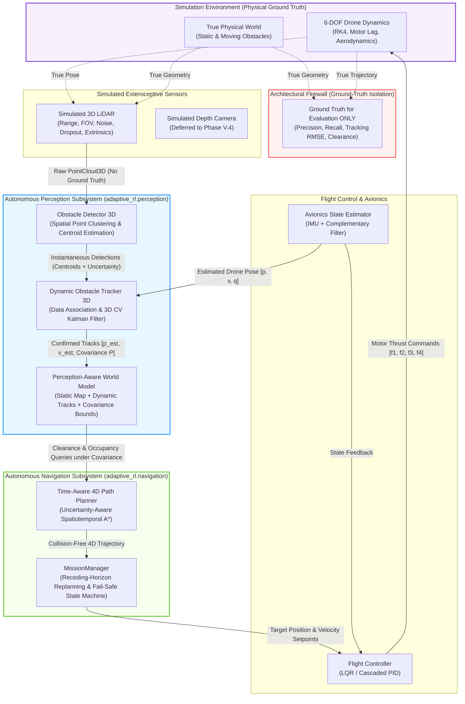
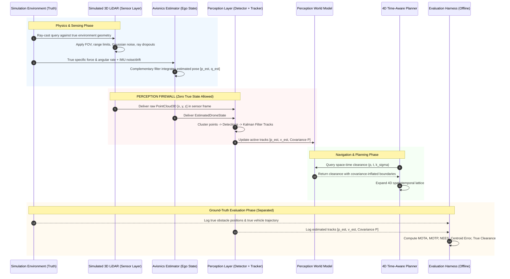
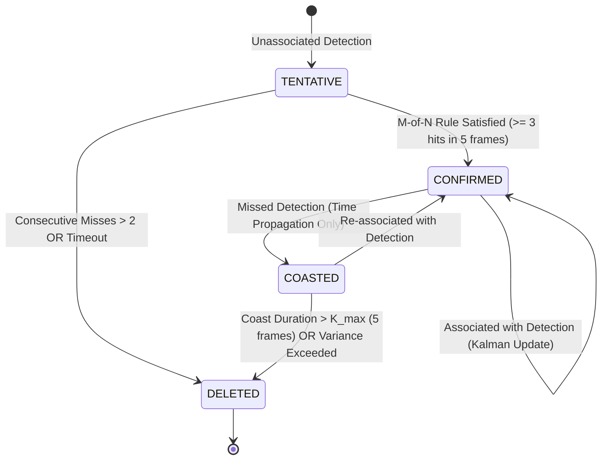
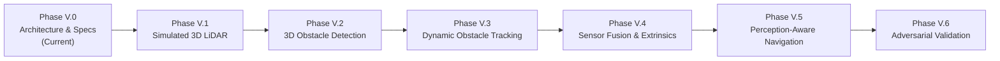

# ARL Phase V.0: Perception-Aware Autonomous Navigation Architecture

## Executive Summary & Mission

AdaptiveRL (ARL) has evolved from kinematic 3D navigation (Phase I/II) to high-fidelity 6-DOF quadrotor dynamics, robust continuous-time LQR control, and sensor-in-the-loop avionics state estimation (Phase III/IV). 

In Phase IV.1, autonomous mission execution and dynamic obstacle avoidance reached a milestone: 4D space-time lattice planning (`TimeAwareAStarPlanner3D`), receding-horizon dynamic replanning (`MissionManager`), and closed-loop feedback driven by noisy avionics state estimation (`IMUSensor` and `ComplementaryFilter`). However, external obstacle avoidance remained completely reliant on direct simulation ground truth: exact analytical equations and positions of static and dynamic obstacles (`ObstacleSphere3D` and `DynamicObstacleSphere3D`) were fed directly from the simulator scenario into the planning engine.

**Phase V establishes the architectural, mathematical, and engineering foundation for Perception-Aware Autonomous Navigation.** 

In Phase V, the quadrotor transitions from navigating via omniscient simulation coordinates to navigating exclusively via uncertain, range-limited, noisy, and potentially occluded exteroceptive sensor observations.



---

## 1. Repository Architecture Audit & Component Inventory

In accordance with Non-Negotiable Engineering Rules 1, 2, and 3, an audit of the current ARL codebase (`origin/feat/phase4-predictive-autonomous-navigation` at commit `763c3da6d2f5e1d2b68730dc862855374b30fda4`) was conducted.

### 1.1 Architecture Inventory & Classification

| Subsystem / Component | Current Implementation Path | Status | Analysis & Role in Phase V |
| :--- | :--- | :--- | :--- |
| **6-DOF Quadrotor Dynamics** | `src/adaptive_rl/environments/drone_6dof.py` | `IMPLEMENTED` | Full rigid-body physics, RK4 integration (5 substeps), quaternion kinematics, motor lag $\tau_{\text{motor}}=0.03\text{ s}$, aerodynamic drag, Cheeseman-Bennett ground effect. Serves as physical ground-truth vehicle simulation. |
| **Drone State Representation** | `DroneState6DOF` in `drone_6dof.py` | `IMPLEMENTED` | Strongly typed dataclass ($p \in \mathbb{R}^3, v \in \mathbb{R}^3, q \in \mathbb{R}^4, \omega \in \mathbb{R}^3$). Scalar-first Hamiltonian quaternion convention. Reused directly across perception and navigation. |
| **Avionics State Estimation** | `IMUSensor` in `sensors/imu.py`<br/>`ComplementaryFilter` in `sensors/estimation.py` | `IMPLEMENTED` | 6-axis IMU (specific force + gyro rate, bias drift) and non-linear SO(3) complementary attitude/position filter. Output `EstimatedDroneState`. Feeds ego-pose into perception tracking and closed-loop flight control. |
| **Static Obstacle Models** | `ObstacleSphere3D` in `environments/drone.py` | `IMPLEMENTED` | Geometric sphere representation ($c \in \mathbb{R}^3, r > 0$). Currently passed directly to planners; in Phase V, restricted to simulation ground-truth and offline validation. |
| **Dynamic Obstacle Models** | `DynamicObstacleSphere3D`<br/>`DivergentDynamicObstacleSphere3D` in `navigation/dynamic_obstacles.py` | `IMPLEMENTED` | Linear reflection ("bounce") and harmonic oscillation moving spheres with analytical bounce-time partitioning and prediction divergence. Serves as ground-truth target motion in simulation. |
| **Static 3D Lattice Planner** | `AStarPlanner3D` in `navigation/planner.py` | `IMPLEMENTED` | 26-connected spatial grid with Euclidean distance heuristic, analytical obstacle inflation, and swept line-of-sight shortcutting. |
| **Time-Aware 4D Path Planner** | `TimeAwareAStarPlanner3D` in `navigation/time_aware_planner.py` | `IMPLEMENTED` | 4D space-time configuration lattice $(x, y, z, t) \in \mathbb{Z}^4$, in-place hover transitions, conservative ceiling time discretization, analytical swept bounding-sphere pre-filtering, and multi-objective route evaluation (`RouteEvaluator`). Will consume `PerceptionWorldModel3D`. |
| **Mission State Machine** | `MissionManager` in `navigation/mission.py` | `IMPLEMENTED` | Receding-horizon clearance monitoring, replanning cooldown hysteresis, off-track deviation triggering, and fail-safe state machine (`IDLE`, `PLANNING`, `EXECUTING`, `WAITING`, `REPLANNING`, `ARRIVED`, `FAILED_BLOCKED`, `ABORTED`). Currently consumes ground truth; will be refactored to consume the perception world model. |
| **Telemetry & Verification** | `FlightScenarioRunner`<br/>`FlightStepTelemetry` in `flight_testing/` | `IMPLEMENTED` | 27 standardized flight scenarios, 8-outcome authoritative taxonomy, cryptographic provenance (`FlightRecord`), continuous analytical clearance evaluation. |
| **Ray-Casting LiDAR Model** | `compute_lidar_3d_readings` in `environments/drone.py` | `PARTIALLY IMPLEMENTED` | 16-ray spherical range-finder with noise and dropout. Used strictly for RL observation vectors in `Drone6DOFEnv`; not modular, lacks point-cloud export, extrinsics, and general exteroceptive perception APIs. |
| **Sensor Abstraction Interface** | `adaptive_rl.perception.sensors` | `NOT PRESENT` | To be specified in Phase V.0 (`BaseSensor3D`, `SensorExtrinsics`, `PointCloud3D`). |
| **3D Obstacle Detection** | `adaptive_rl.perception.detection` | `NOT PRESENT` | Point cloud clustering, centroid estimation, and measurement uncertainty estimation. Planned for Phase V.2. |
| **Dynamic Obstacle Tracking** | `adaptive_rl.perception.tracking` | `NOT PRESENT` | Data association, track persistence, and Kalman state estimation $[p, v, \Sigma]$. Planned for Phase V.3. |
| **Perception World Model** | `adaptive_rl.perception.world_model` | `NOT PRESENT` | Spatial and spatiotemporal occupancy, track management, and covariance-inflated clearance queries. Planned for Phase V.5. |
| **Adversarial Perception Suite**| `tests/test_perception_adversarial.py`| `NOT PRESENT` | Dropout, latency, occlusion, false positives/negatives, and divergence testing. Planned for Phase V.6. |

---

## 2. Information-Flow Boundary & Ground-Truth Isolation

The foundational scientific requirement of Phase V is **Ground-Truth Isolation**:
> The path planner, world model, tracking filters, and flight controllers must never access hidden simulation ground-truth objects (`ObstacleSphere3D`, `DynamicObstacleSphere3D`, or true world obstacles).

### 2.1 The Architectural Firewall



### 2.2 Domain Separation Rules
1. **Simulation Domain (Privileged):**
   - Owns exact physics parameters, ground-truth obstacle trajectories, wind velocity, and true quadrotor state.
   - Generates simulated sensor measurements.
   - Never referenced by planning or decision-making modules.
2. **Autonomous Avionics Domain (Unprivileged):**
   - Receives only raw sensor packets (`PointCloud3D`, `IMUMeasurement`).
   - Receives ego-state estimates only from onboard state estimation (`EstimatedDroneState`).
   - All spatial obstacle representations are generated by perception algorithms.
3. **Evaluation Subsystem (Offline Verification):**
   - The only component permitted to bridge both domains.
   - Compares autonomous avionics estimates against simulation ground truth to calculate scientific performance metrics (localization error, detection precision/recall, track continuity, and true physical clearance).
   - Operates strictly after or parallel to the simulation step; no evaluation metric can feed back into control decisions.

---

## 3. Coordinate Frames, Kinematic Conventions & Transformations

To prevent catastrophic frame-of-reference errors, Phase V strictly adheres to the existing coordinate and rotation standards established in `DroneDynamics6DOF` and `IMUSensor`.

### 3.1 Standard Frame Definitions

| Frame Name | Symbol | Standard Convention | Origin | Axis Directions |
| :--- | :--- | :--- | :--- | :--- |
| **World Frame** | $\mathcal{F}_W$ | **East-North-Up (ENU)** Cartesian | Fixed inertial datum $(0, 0, 0)$ at arena floor | $+X_W$: East<br/>$+Y_W$: North<br/>$+Z_W$: Up (vertical altitude against gravity; floor at $Z=0$) |
| **Body Frame** | $\mathcal{F}_B$ | **Forward-Left-Up (FLU)** Cartesian | Quadrotor Center of Mass (CoM) | $+X_B$: Forward (nose, forward flight heading)<br/>$+Y_B$: Left (port arm direction)<br/>$+Z_B$: Up (normal to rotor plane; collective thrust along $+Z_B$) |
| **Sensor Frame** | $\mathcal{F}_S$ | **Forward-Left-Up (FLU)** Sensor Datum | Optical / mechanical emitter focal center | $+X_S$: Sensor Boresight (pointing forward)<br/>$+Y_S$: Sensor Left<br/>$+Z_S$: Sensor Up |
| **Optical Adapter** | $\mathcal{F}_{\text{opt}}$ | Computer Vision Convention | Camera focal center | $+Z_{\text{opt}}$: Optical axis (forward)<br/>$+X_{\text{opt}}$: Image Right<br/>$+Y_{\text{opt}}$: Image Down |

### 3.2 Attitude & Rotation Representations
- **Attitude Representation:** Unit quaternion $\mathbf{q} = [q_w, q_x, q_y, q_z] \in \mathbb{R}^4$ with scalar-first Hamiltonian convention ($\|\mathbf{q}\|_2 = 1.0$).
- **Rotation Matrix ($R_B^W(\mathbf{q}) \in \mathrm{SO}(3)$):**
  Transforms vectors from the Body Frame $\mathcal{F}_B$ to the World Frame $\mathcal{F}_W$:
  $$\mathbf{v}_W = R_B^W(\mathbf{q}) \mathbf{v}_B$$
  where $R_B^W(\mathbf{q})$ is evaluated via `quaternion_to_rotation_matrix(q)` in `drone_6dof.py`:
  $$R_B^W(\mathbf{q}) = \begin{bmatrix}
  1 - 2(q_y^2 + q_z^2) & 2(q_x q_y - q_w q_z) & 2(q_x q_z + q_w q_y) \\
  2(q_x q_y + q_w q_z) & 1 - 2(q_x^2 + q_z^2) & 2(q_y q_z - q_w q_x) \\
  2(q_x q_z - q_w q_y) & 2(q_y q_z + q_w q_x) & 1 - 2(q_x^2 + q_y^2)
  \end{bmatrix}$$
- **Inverse Transformation:** Since $R \in \mathrm{SO}(3)$, the world-to-body mapping is the matrix transpose:
  $$\mathbf{v}_B = (R_B^W)^T \mathbf{v}_W = R_W^B \mathbf{v}_W$$

### 3.3 Sensor Extrinsics & Transformation Pipeline
A range sensor mounted on the quadrotor airframe is parameterized by its rigid-body extrinsic calibration:
- Translation vector: $\mathbf{p}_S^B = [x_{\text{mount}}, y_{\text{mount}}, z_{\text{mount}}]^T \in \mathbb{R}^3$ (position of sensor relative to vehicle CoM in body frame).
- Rotation matrix: $R_S^B \in \mathrm{SO}(3)$ (orientation of sensor relative to body frame).

For any 3D point $\mathbf{p}_S = [x_s, y_s, z_s]^T$ observed in the sensor frame at timestamp $t$:
1. **Sensor to Body Transformation:**
   $$\mathbf{p}_B = \mathbf{p}_S^B + R_S^B \mathbf{p}_S$$
2. **Body to World Transformation:**
   $$\mathbf{p}_W(t) = \hat{\mathbf{p}}_B^W(t) + R_B^W(\hat{\mathbf{q}}(t)) \mathbf{p}_B$$
   where $\hat{\mathbf{p}}_B^W(t)$ and $\hat{\mathbf{q}}(t)$ are the estimated position and attitude quaternion supplied by the onboard avionics estimator (`EstimatedDroneState`).

### 3.4 Temporal Synchronization & Latency
- Simulation runs on master discrete time $t_{\text{sim}} = k \cdot \Delta t_{\text{sim}}$ with $\Delta t_{\text{sim}} = 0.05\text{ s}$ ($20\text{ Hz}$).
- Sensors operate with configurable update period $\Delta t_{\text{sensor}}$ (e.g. $10\text{ Hz}$ or $20\text{ Hz}$).
- Sensor latency $\tau_{\text{latency}}$ models transmission and processing delays. When point cloud data arrives at $t_{\text{arrival}} = t_{\text{meas}} + \tau_{\text{latency}}$, the transformation pipeline queries the vehicle pose history buffer at epoch $t_{\text{meas}}$ to perform motion-compensated spatial projection, preventing rotational smearing.

---

## 4. Sensor Abstraction Layer & Data Contracts

### 4.1 Sensor Prioritization: 3D LiDAR First
ARL Phase V selects a **Simulated 3D Scanning LiDAR** as the primary exteroceptive sensor, deferring Depth Cameras to Phase V.4:
1. **Direct Spatial Geometry:** LiDAR produces Cartesian coordinate point clouds $[x, y, z]$ directly, requiring no camera pinhole projection matrices, lens distortion inversion, or dense pixel de-projection.
2. **Computational Performance in Pure Python/NumPy:** A 3D multi-beam LiDAR sweep of 64–256 rays can be evaluated analytically via vectorized ray-sphere/ray-box intersections in $< 5\text{ ms}$, preserving high simulation frame rates ($> 100\text{ Hz}$). Simulating a VGA depth frame ($640 \times 480 = 307{,}200$ pixels) in pure Python without dedicated GPU rasterization would bottleneck execution.
3. **Low-Dependency Mandate:** Spatial point-cloud filtering and clustering can be implemented cleanly with `numpy` and `scipy.spatial` (KD-tree nearest neighbor searches), adhering strictly to Rule 4.

### 4.2 Strongly Typed Data Contracts (`adaptive_rl.perception.sensors`)

> [!IMPORTANT]
> The data contracts specified below are **ARCHITECTURAL SPECIFICATIONS** for implementation in Phase V.1 (`adaptive_rl.perception.sensors`). They are not present in the Phase V.0 repository.

```python
from __future__ import annotations
from dataclasses import dataclass
from enum import Enum
from typing import Any, Dict, List, Optional, Tuple
import numpy as np

@dataclass(frozen=True)
class SensorExtrinsics:
    """Rigid-body pose of the sensor relative to the vehicle body frame (FLU)."""
    translation_b: np.ndarray       # [x, y, z] in meters relative to CoM
    rotation_s_to_b: np.ndarray     # 3x3 orthonormal rotation matrix R_S^B (maps v_S to v_B = R_S^B * v_S)

    def to_dict(self) -> Dict[str, Any]:
        return {
            "translation_b": [round(float(x), 4) for x in self.translation_b],
            "rotation_s_to_b": [[round(float(c), 4) for c in row] for row in self.rotation_s_to_b],
        }

@dataclass(frozen=True)
class SensorConfig3D:
    """Configuration parameters for 3D range-sensing exteroceptive sensors."""
    sensor_id: str = "lidar_primary"
    update_rate_hz: float = 20.0
    min_range_m: float = 0.2
    max_range_m: float = 25.0
    horizontal_fov_deg: float = 360.0    # Omnidirectional azimuth or forward sector
    vertical_fov_deg: float = 60.0        # Elevation span [-30 deg, +30 deg]
    horizontal_beams: int = 32           # Azimuth rays
    vertical_beams: int = 8              # Elevation layers
    range_noise_std_m: float = 0.03      # Zero-mean Gaussian range error
    dropout_probability: float = 0.02    # Statistical beam loss (dust, absorption)
    latency_sec: float = 0.02            # Sensor readout and transport latency
    extrinsics: Optional[SensorExtrinsics] = None

@dataclass(frozen=True)
class PointCloud3D:
    """Immutable point cloud observation generated by a 3D range sensor."""
    timestamp: float                    # Measurement epoch in simulation seconds
    frame_id: str                       # Coordinate frame ("sensor", "body", "world")
    points: np.ndarray                  # (N, 3) float64 Cartesian coordinates [x, y, z]
    ranges: np.ndarray                  # (N,) float32 measured radial distances
    valid_mask: np.ndarray              # (N,) bool array (True = valid echo, False = dropped/out-of-range)
    sensor_id: str
    extrinsics: SensorExtrinsics
    sensor_origin_w: Optional[np.ndarray] = None # Sensor position in world frame at capture
```

#### Array Immutability, Defensive Copying & Shape Validation
In Python, `@dataclass(frozen=True)` prevents attribute reassignment (`obj.points = ...`), but **does not make the underlying NumPy array buffers read-only** (`obj.points[0, 0] = ...` would silently mutate memory).
To enforce strict scientific data integrity in Phase V.1 implementations:
- **Read-Only Buffers:** Constructors must explicitly set `points.flags.writeable = False` and `valid_mask.flags.writeable = False`.
- **Defensive Ingestion:** All array parameters must be copied on ingestion (`np.copy()`).
- **Shape and Finite-Value Preconditions:** Arrays must be validated for exact dimensions (`points.shape == (N, 3)`, `ranges.shape == (N,)`, `valid_mask.shape == (N,)`) and points with `valid_mask == True` must satisfy `np.all(np.isfinite(points[valid_mask]))`. Dropped or out-of-range returns must be flagged `valid_mask = False` and must **never** be silently converted to `0.0 m` or `max_range`.

---

## 5. 3D Obstacle Detection Representation

A sensor point cloud contains individual spatial returns, not semantic objects. The detection layer processes raw point clouds into discrete candidate obstacle instances.

```python
@dataclass(frozen=True)
class ObstacleDetection3D:
    """Instantaneous spatial obstacle detection produced by clustering algorithms."""
    detection_id: str                   # Ephemeral UUID for this observation frame
    timestamp: float                    # Capture timestamp in simulation seconds
    frame_id: str                       # Coordinate frame (strictly "world" after projection)
    centroid: np.ndarray                # [x, y, z] estimated cluster center in meters
    bounding_radius: float              # Enclosing spherical radius in meters
    covariance_position: np.ndarray     # (3, 3) spatial covariance matrix Sigma_pos
    point_count: int                    # Number of point returns supporting this cluster
    confidence: float                   # Detection confidence score in [0.0, 1.0]
    sensor_id: str                      # Originating sensor
    is_valid: bool = True               # Validity flag (rejected if non-finite coordinates)
```

### 5.1 Physical Extent, Measurement Noise, and Surface Dispersion
A critical scientific error is assuming that the spatial dispersion of detected points is identical to sensor measurement noise. In Phase V, the detection layer strictly distinguishes five distinct physical and geometric quantities:

1. **Physical Obstacle Extent:** The true volumetric geometry of the obstacle (e.g. solid sphere of radius $r^*$ or bounding box).
2. **Visible Surface Dispersion ($\Sigma_{\text{surface}}$):** LiDAR rays do not penetrate obstacles; they reflect exclusively from the front-facing exterior surface manifold. The sample dispersion matrix:
   $$\Sigma_{\text{surface}} = \frac{1}{N-1} \sum_{i=1}^N (\mathbf{p}_i - \bar{\mathbf{p}})(\mathbf{p}_i - \bar{\mathbf{p}})^T$$
   measures the **geometric shape and curvature of the visible surface patch**, NOT sensor measurement error.
3. **LiDAR Range Measurement Noise in Cartesian Space:**
   Each beam measures radial distance $r_i$ along unit direction vector $\mathbf{u}_i = [\cos\phi_i \cos\theta_i, \cos\phi_i \sin\theta_i, \sin\phi_i]^T$ with radial standard deviation $\sigma_r$ and angular beam pointing noise $\sigma_{\text{beam}}$.
   The 3D Cartesian measurement covariance for each individual return point is:
   $$\Sigma_{\mathbf{p}_i} = \sigma_r^2 \mathbf{u}_i \mathbf{u}_i^T + (r_i \sigma_{\text{beam}})^2 (I - \mathbf{u}_i \mathbf{u}_i^T)$$
   Because $\sigma_r \gg r_i \sigma_{\text{beam}}$ for high-accuracy pulsed LiDAR, measurement uncertainty is highly anisotropic, dominated along the line-of-sight ray axis $\mathbf{u}_i$.
4. **Centroid Estimation Bias under Partial Observation:**
   Because the sensor observes only the facing hemisphere, the naive sample mean $\bar{\mathbf{p}} = \frac{1}{N} \sum_{i=1}^N \mathbf{p}_i$ is **systematically biased toward the sensor** relative to the true volumetric center $\mathbf{c}^*$. For a sphere of radius $r$, the centroid of a uniform hemisphere lies at distance $\frac{1}{2} r$ from the true center along the viewing ray:
   $$\mathbf{c}^* \approx \bar{\mathbf{p}} + \frac{1}{2} r^* \mathbf{u}_{\text{view}}$$
   Using $\bar{\mathbf{p}}$ without depth correction places the estimated obstacle center too close to the quadrotor.
5. **Occlusion & Conservative Bounding Geometry:**
   The rear side of an obstacle is unobserved. Bounding radius $\hat{r} = \max_i \|\mathbf{p}_i - \bar{\mathbf{p}}\|$ measures only the visible surface chord and underestimates full physical extent. In Phase V.2, obstacle bounding must fit a parametric spherical surface model $\min_{\mathbf{c}, r} \sum_i (\|\mathbf{p}_i - \mathbf{c}\| - r)^2$ or enforce a conservative depth inflation margin $\hat{r}_{\text{conservative}} = \hat{r} + \delta_{\text{depth}}$.

> [!NOTE]
> **Open Design Questions for Phase V.2:**
> 1. Optimal numerical solver for non-linear sphere fitting under sparse beam returns ($N < 8$ points per obstacle).
> 2. Analytical propagation of spherical surface-fit residuals into the $3 \times 3$ centroid covariance matrix $R$.

---

## 6. Dynamic Obstacle Tracking Subsystem

Instantaneous detections cannot be passed directly to the trajectory planner. An instantaneous detection:
- Provides no velocity vector.
- May be a transient false-positive.
- Disappears during momentary sensor occlusions or dropouts.

The **Dynamic Obstacle Tracker** (`DynamicObstacleTracker3D`) bridges instantaneous detections into persistent spatiotemporal tracks.

### 6.1 Track Lifecycle State Machine



### 6.2 3D Constant Velocity (CV) Kalman Filter Specification
Each active track maintains a 6-dimensional state vector $\mathbf{x} \in \mathbb{R}^6$ and $6 \times 6$ error covariance matrix $P$:
$$\mathbf{x} = \begin{bmatrix} x & y & z & v_x & v_y & v_z \end{bmatrix}^T = \begin{bmatrix} \mathbf{p} \\ \mathbf{v} \end{bmatrix}$$

#### A. Motion Prediction Step (Time Update)
Propagating from timestamp $t_{k-1}$ to $t_k$ over interval $\Delta t = t_k - t_{k-1}$:
$$\hat{\mathbf{x}}_{k|k-1} = F(\Delta t) \hat{\mathbf{x}}_{k-1|k-1}$$
$$P_{k|k-1} = F(\Delta t) P_{k-1|k-1} F(\Delta t)^T + Q(\Delta t)$$

Where the transition matrix $F(\Delta t)$ and discrete process noise matrix $Q(\Delta t)$ under continuous white-noise acceleration $q_{\text{accel}}$ are:
$$F(\Delta t) = \begin{bmatrix} I_{3 \times 3} & \Delta t \cdot I_{3 \times 3} \\ 0_{3 \times 3} & I_{3 \times 3} \end{bmatrix}$$
$$Q(\Delta t) = q_{\text{accel}} \begin{bmatrix} \frac{\Delta t^3}{3} I_{3 \times 3} & \frac{\Delta t^2}{2} I_{3 \times 3} \\ \frac{\Delta t^2}{2} I_{3 \times 3} & \Delta t \cdot I_{3 \times 3} \end{bmatrix}$$

#### B. Measurement Model
The detector observes spatial centroids $\mathbf{z}_k = [x_m, y_m, z_m]^T \in \mathbb{R}^3$:
$$\mathbf{z}_k = H \mathbf{x}_k + \boldsymbol{\eta}_k, \quad \boldsymbol{\eta}_k \sim \mathcal{N}(\mathbf{0}, R_k)$$
$$H = \begin{bmatrix} I_{3 \times 3} & 0_{3 \times 3} \end{bmatrix} \in \mathbb{R}^{3 \times 6}$$

#### C. Data Association & Gating
For each candidate pair of track $i$ and detection $j$:
1. **Innovation Vector & Innovation Covariance:**
   $$\mathbf{y}_{ij} = \mathbf{z}_j - H \hat{\mathbf{x}}_{i, k|k-1}$$
   $$S_{ij} = H P_{i, k|k-1} H^T + R_j \in \mathbb{R}^{3 \times 3}$$
2. **Mahalanobis Distance Gating:**
   $$d_{M, ij}^2 = \mathbf{y}_{ij}^T S_{ij}^{-1} \mathbf{y}_{ij}$$
   A pair is gated out if $d_{M, ij}^2 > \gamma_{\text{gate}}$, where $\gamma_{\text{gate}} = \chi^2_3(0.99) \approx 11.34$.
3. **Global Association:**
   The gated cost matrix $C_{ij} = d_{M, ij}^2$ is solved globally using the Hungarian algorithm (`scipy.optimize.linear_sum_assignment`), guaranteeing globally optimal assignment without greedy race conditions.

#### D. Measurement Correction Step (Information Update)
For each associated track:
$$K_k = P_{k|k-1} H^T S_k^{-1} \in \mathbb{R}^{6 \times 3}$$
$$\hat{\mathbf{x}}_{k|k} = \hat{\mathbf{x}}_{k|k-1} + K_k \mathbf{y}_k$$
To ensure numerical symmetry and positive semi-definiteness, covariance is updated via the **Joseph stabilized formulation**:
$$P_{k|k} = (I - K_k H) P_{k|k-1} (I - K_k H)^T + K_k R_k K_k^T$$

---

## 7. Uncertainty Representation & Covariance-Aware Planning

Uncertainty must directly inform path planning. If an obstacle has high velocity dispersion or has been coasted without observation, the navigation system must defensively maintain wider separation.

### 7.1 Forward Uncertainty Propagation
When the planner evaluates trajectory clearance over lookahead horizon $\tau = t_{\text{eval}} - t_{\text{curr}} > 0$:
The spatial position covariance $\Sigma_p(t + \tau)$ propagates analytically as:
$$\Sigma_p(t + \tau) = \Sigma_p(t) + \tau \left(\Sigma_{pv}(t) + \Sigma_{pv}(t)^T\right) + \tau^2 \Sigma_v(t) + \frac{\tau^3}{3} q_{\text{accel}} I_{3 \times 3}$$

Key mathematical properties:
- **Velocity Uncertainty Amplification:** Uncertainty grows quadratically with velocity variance ($\tau^2 \Sigma_v$).
- **Coasting Growth:** If observations cease, covariance grows monotonically, forcing the planner to increase clearance.

### 7.2 Isotropic Bounding Sphere Formulation
To evaluate continuous swept clearance across thousands of candidate 4D lattice edges in milliseconds, the 3D confidence ellipsoid is conservatively bounded by an isotropic bounding sphere derived from its spectral radius:
$$\sigma_{\max}(\tau) = \sqrt{\lambda_{\max}(\Sigma_p(t + \tau))}$$

**Perception-Aware Effective Obstacle Radius:**
$$r_{\text{effective}}(t + \tau) = \hat{r}_{\text{obs}} + r_{\text{vehicle}} + \delta_{\text{nominal}} + k_{\sigma} \cdot \sigma_{\max}(\tau)$$
where:
- $\hat{r}_{\text{obs}}$: Estimated physical obstacle radius.
- $r_{\text{vehicle}} = 0.25\text{ m}$: Bounding radius of the quadrotor.
- $\delta_{\text{nominal}} = 0.15\text{ m}$: Base aerodynamic/control margin.
- $k_{\sigma}$: Confidence scaling multiplier derived from Chi-squared distribution $\chi^2_3$.
  For 3D position error $\tilde{\mathbf{p}} \sim \mathcal{N}(\mathbf{0}, \Sigma_p)$, the squared Mahalanobis distance $\epsilon = \tilde{\mathbf{p}}^T \Sigma_p^{-1} \tilde{\mathbf{p}}$ follows a $\chi^2_3$ distribution. The containment probability $P$ inside the ellipsoid $\epsilon \le k_{\sigma}^2$ is:
  $$P(\epsilon \le k_{\sigma}^2) = F_{\chi^2_3}(k_{\sigma}^2) = 2 \Phi(k_{\sigma}) - 1 - \sqrt{\frac{2}{\pi}} k_{\sigma} e^{-k_{\sigma}^2 / 2}$$
  Evaluating this:
  - $k_{\sigma} = 3.0$ yields $F_{\chi^2_3}(9.0) \approx 0.9707$ ($97.07\%$ containment, not $98.9\%$, which is the 2D value $1 - e^{-4.5}$).
  - For $95\%$ containment: $k_{\sigma} = \sqrt{\chi^2_3(0.95)} = \sqrt{7.8147} \approx 2.795$.
  - For $99\%$ containment: $k_{\sigma} = \sqrt{\chi^2_3(0.99)} = \sqrt{11.3449} \approx 3.368$.
  Default configuration adopts $k_{\sigma} = 3.0$ ($97.07\%$ containment) with $k_{\sigma} = 3.37$ ($99.0\%$ containment) available for tight corridors.

```text
       True Physical Obstacle:   [  Radius r_obs  ]
       Vehicle Body Margin:      [ + r_vehicle ]
       Baseline Safety Margin:   [ + delta_nom ]
       Uncertainty Inflation:    [ + k_sigma * sqrt(lambda_max(Sigma_p(t+tau))) ]
       -------------------------------------------------------------------------
       Total Effective Radius:   ==================> r_effective(t+tau)
```

---

## 8. Perception-Aware World Model & Planner Integration

### 8.1 Abstract World Model Interface (`WorldModelInterface`)

The interface decouples motion planners from the perception subsystem:

```python
from abc import ABC, abstractmethod
from typing import Sequence, Tuple

class WorldModelInterface(ABC):
    """Abstract spatial and spatiotemporal environment interface for path planners."""

    @abstractmethod
    def query_clearance(
        self,
        position: np.ndarray,
        time_sec: float,
        vehicle_radius: float = 0.25,
        confidence_k: float = 3.0,
    ) -> float:
        """Calculate signed minimum distance to nearest obstacle boundary at time_sec.
        Returns positive when clear, negative when intersecting.
        """
        pass

    @abstractmethod
    def is_transition_valid(
        self,
        p_start: np.ndarray,
        p_end: np.ndarray,
        t_start: float,
        t_end: float,
        vehicle_radius: float = 0.25,
        confidence_k: float = 3.0,
    ) -> Tuple[bool, float]:
        """Continuous swept clearance check across space-time segment [p_start, p_end].
        Returns:
            (is_valid, min_clearance_along_segment)
        """
        pass

    @abstractmethod
    def query_occupancy(
        self,
        position: np.ndarray,
        time_sec: float,
    ) -> str:
        """Classify spatial point as 'free', 'occupied', or 'unknown'."""
        pass
```

### 8.2 Planner Integration Architecture
- `PerceptionWorldModel3D` implements `WorldModelInterface` for production perception-aware navigation, fed by active tracks and static background maps.
- `GroundTruthWorldModelAdapter` implements `WorldModelInterface` wrapping legacy `ObstacleSphere3D` and `DynamicObstacleSphere3D` lists, preserving 100% backward compatibility for all Phase III/IV regression tests.
- `TimeAwareAStarPlanner3D` and `MissionManager` are refactored to query `WorldModelInterface`, achieving total isolation from simulator internals.

---

## 9. Safety, Fail-Safe Behavior & Unknown-Space Policy

### 9.1 Authoritative Perception Fail-Safe Matrix

| Failure Mode | Trigger / Detection | Immediate Algorithmic Action | Mission State Transition |
| :--- | :--- | :--- | :--- |
| **Non-Finite Sensor Data** | `np.isnan(points).any()` or `np.isinf(points).any()` | Drop corrupted returns; flag `valid_mask = False`; **never** map invalid returns to $0.0\text{ m}$ (phantom collision) or `max_range` (obstacle masking). | Maintain state; if corrupted frames persist $> 3$ consecutive frames $\to$ `ABORTED` |
| **Invalid Covariance Matrix** | Non-symmetric or $\min(\text{eig}(P)) \le 0$ | Apply Joseph stabilization $P = (I-KH)P(I-KH)^T + KRK^T$; enforce symmetry $\frac{1}{2}(P+P^T)$; clamp eigenvalues $\ge 10^{-8}$; if uncorrectable, delete track. | Invalidate track; re-evaluate world model clearance |
| **Sensor Transport Latency** | $t_{\text{now}} - t_{\text{meas}} > 0.20\text{ s}$ | Query historical pose buffer at measurement epoch $t_{\text{meas}}$ for spatial projection; inflate measurement noise covariance $R$. | Continue; if latency $> 0.50\text{ s}$ log critical latency alert |
| **Brief Sensor Dropout** | No frame for $\Delta t \le 0.30\text{ s}$ ($\le 6$ steps at 20 Hz) | Coast active tracks forward via Kalman filter motion model; monotonically inflate spatial covariance $\Sigma_p(t)$; enforce braking horizon speed limit. | Maintain `EXECUTING` (no abrupt abort) |
| **Sustained Sensor Dropout** | Dropout duration $0.30\text{ s} < \Delta t \le 2.0\text{ s}$ | Freeze forward path progression; command immediate deceleration to zero-velocity stationary hover hold. | Transition to `WAITING` (Safe Hover Hold) |
| **Terminal Sensor Outage** | Dropout duration exceeds $T_{\text{outage}} = 2.0\text{ s}$ | Terminate active mission execution; prohibit further path planning; command controlled vertical descent ($v_z = -0.5\text{ m/s}$) to safe landing. | Transition from `WAITING` to `FAILED_BLOCKED` |
| **Loss of Localization Aiding** | Reference position/altitude drops out | Attitude remains stabilized via IMU gravimetric leveling; horizontal position drifts open-loop; command immediate zero-velocity hover hold; if unaided duration $> 3.0\text{ s} \to$ controlled descent. | Transition to `WAITING` $\to$ `FAILED_BLOCKED` |
| **Excessive Track Uncertainty** | $\sigma_{\max} = \sqrt{\lambda_{\max}(\Sigma_p)} > 2.5\text{ m}$ | Treat track as large spatial exclusion sphere ($r_{\text{eff}} = \hat{r}_{\text{obs}} + 2.5\text{ m}$); trigger replanning. If no safe alternative corridor exists $\to$ hover hold. | Trigger `REPLANNING`; if blocked $\to$ `WAITING` |
| **Track Stagnation** | Track unobserved for $> K_{\text{max\_coast}}$ (5 frames) | Purge track from active memory; clear associated world-model exclusion volume. | Re-evaluate world model clearance |
| **Corrupted Vehicle Ego-Pose** | $|\|\mathbf{q}\| - 1.0| \ge 0.05$ or non-finite pose | Fail closed immediately; never substitute ground truth; cut autonomous planning. | Transition immediately to `ABORTED` |

### 9.2 Unknown-Space Policy: Delay-Aware Braking Horizon Constraint
In real flight, space that has not been scanned by the sensor is **unknown**, not guaranteed free.
- **Initial Path Generation:** At mission launch, global planning allows routes through unobserved space under the provision that local execution will continuously verify clearance.
- **Physical Response Delay Decomposition:**
  When an obstacle appears at the boundary of verified visible free space, the aircraft cannot decelerate instantaneously. The total system response delay $\tau_{\text{delay}}$ comprises:
  $$\tau_{\text{delay}} = \tau_{\text{sensor}} + \tau_{\text{proc}} + \tau_{\text{replan}} + \tau_{\text{attitude}} + \tau_{\text{motor}}$$
  where nominal values under standard 20 Hz simulation are:
  - $\tau_{\text{sensor}} = 1 / f_{\text{sensor}} \approx 0.050\text{ s}$ (sensor measurement period).
  - $\tau_{\text{proc}} \approx 0.020\text{ s}$ (point-cloud clustering and detection pipeline latency).
  - $\tau_{\text{replan}} \approx 0.010\text{ s}$ (tracker update and mission replanning check).
  - $\tau_{\text{attitude}} \approx 0.100\text{ s}$ (time required to tilt quadrotor to maximum braking pitch attitude $\theta_{\text{brake}}$).
  - $\tau_{\text{motor}} \approx 0.030\text{ s}$ (first-order brushless motor thrust lag).
  Nominal demonstrated total response delay is $\tau_{\text{delay}} \approx 0.21\text{ s}$.

- **Delay-Aware Braking Horizon Inequality:**
  During delay $\tau_{\text{delay}}$, the quadrotor continues traveling forward at speed $v$. Under demonstrated conservative horizontal braking deceleration $a_{\min} > 0$, the total stopping distance is:
  $$d_{\text{stop}}(v) = v \cdot \tau_{\text{delay}} + \frac{v^2}{2 a_{\min}}$$
  To guarantee that the aircraft can come to a complete stationary hover within verified visible free space $d_{\text{available}} = \max\left(0, d_{\text{visible}} - d_{\text{margin}}\right)$, the velocity must satisfy:
  $$\frac{1}{2 a_{\min}} v^2 + \tau_{\text{delay}} v - d_{\text{available}} \le 0$$
  Solving the quadratic inequality for the positive velocity root yields the **Delay-Aware Braking Horizon Bound**:
  $$v_{\text{max\_allowed}} = a_{\min} \left( \sqrt{\tau_{\text{delay}}^2 + \frac{2 d_{\text{available}}}{a_{\min}}} - \tau_{\text{delay}} \right)$$

  > [!NOTE]
  > The elementary formula $v = \sqrt{2 a d}$ is strictly an idealized zero-delay ($\tau_{\text{delay}} = 0$) special case. Assuming $\tau = 0$ on physical aircraft causes substantial stopping-distance undershoot and collisions. Physical stopping guarantees are valid only when calibrated against experimentally validated $\tau_{\text{delay}}$ and $a_{\min}$ bounds.

- **Blind Corridor Prohibition:**
  If an upcoming waypoint segment has zero sensor coverage and verified visible distance $d_{\text{available}} = 0$, $v_{\text{max\_allowed}}$ evaluates to $0.0\text{ m/s}$. The mission transitions to `WAITING` and commands a local yaw sensor sweep or stationary hover hold until visibility is acquired.

### 9.3 Scope & Certification Disclaimer
ARL is an open-source research and engineering simulation platform. While these fail-safe rules are designed on aerospace defense principles, this software architecture does not constitute physical aircraft airworthiness certification under FAA/EASA regulations (such as RTCA DO-178C, DO-254, or SORA). Physical flight requires redundant physical sensors, independent flight termination systems (FTS), and hardware-in-the-loop validation.

---

## 10. Phase V Implementation Roadmap (Phases V.0 – V.6)



### Phase V.0 — Architecture, Scientific Specification & Engineering Foundation (Current)
- **Prerequisites:** Verified Phase IV base commit (`763c3da6d2f5e1d2b68730dc862855374b30fda4`).
- **Deliverables:** `PHASE_V_PERCEPTION_ARCHITECTURE.md`, `PHASE_V_VALIDATION_PLAN.md`, ADRs 001–008, updated navigation documentation.
- **Dependencies:** Pure documentation; zero code or dependency changes.
- **Completion Criteria:** Architecture approved; ground-truth isolation formally specified; zero regression in Phase IV tests.

### Phase V.1 — Simulated Sensor Foundation
- **Prerequisites:** Phase V.0 specification approved.
- **Deliverables:** `adaptive_rl.perception.sensors` module; `BaseSensor3D`, `SensorConfig3D`, `SimulatedLiDAR3D`; vectorized NumPy ray-sphere/box intersection; noise, dropout, and latency models.
- **Dependencies:** `numpy`, `scipy.spatial`.
- **Tests:** `tests/test_simulated_lidar.py` (range accuracy, noise distribution, dropout statistics, extrinsic transformations, execution throughput $> 50\text{ Hz}$).
- **Completion Criteria:** Simulated LiDAR produces `PointCloud3D` at $\ge 20\text{ Hz}$ with verified noise statistics.

### Phase V.2 — 3D Obstacle Detection
- **Prerequisites:** Phase V.1 sensor streams operational.
- **Deliverables:** `adaptive_rl.perception.detection` module; `ObstacleDetector3D`; spatial KD-tree Euclidean clustering, centroid and bounding radius estimation, measurement covariance calculation.
- **Dependencies:** `numpy`, `scipy.spatial`.
- **Tests:** `tests/test_obstacle_detector_3d.py` (cluster separation, centroid error $\le 0.1\text{ m}$, false positive rejection, non-finite input guards).
- **Completion Criteria:** Centroid localization RMSE $< 0.15\text{ m}$ across isolated spherical obstacles; detection precision $\ge 95\%$.

### Phase V.3 — Dynamic Obstacle Tracking
- **Prerequisites:** Phase V.2 detector output.
- **Deliverables:** `adaptive_rl.perception.tracking` module; `DynamicObstacleTracker3D`; 3D CV Kalman Filter, Hungarian data association, Mahalanobis gating, track lifecycle state machine ($M$-of-$N$ confirmation, coasting, deletion).
- **Dependencies:** `numpy`, `scipy.optimize`.
- **Tests:** `tests/test_dynamic_obstacle_tracker.py` (linear tracking, bouncing obstacle recovery, ID consistency, covariance validity, coasting behavior).
- **Completion Criteria:** Track velocity estimation error $< 0.2\text{ m/s}$; zero identity switches across standard dynamic crossing scenarios; covariance remains positive semi-definite.

### Phase V.4 — Sensor Fusion & Multi-Rate Integration
- **Prerequisites:** Phase V.3 tracking engine.
- **Deliverables:** Asynchronous temporal alignment; sensor extrinsics calibration pipeline; IMU-LiDAR state synchronization; ego-motion compensation.
- **Dependencies:** `numpy`, `scipy`.
- **Tests:** `tests/test_sensor_fusion.py` (spatial projection under high quadrotor angular rate, latency buffer accuracy).
- **Completion Criteria:** Projected point cloud spatial error $< 0.05\text{ m}$ under $30^\circ/\text{s}$ vehicle yaw rotation.

### Phase V.5 — Perception-Aware Navigation & Planning
- **Prerequisites:** Phase V.3 tracker and Phase V.4 synchronization.
- **Deliverables:** `adaptive_rl.perception.world_model` module; `PerceptionWorldModel3D`, `GroundTruthWorldModelAdapter`; refactor `TimeAwareAStarPlanner3D` and `MissionManager` to query `WorldModelInterface`.
- **Dependencies:** Existing ARL planning stack.
- **Tests:** `tests/test_perception_aware_navigation.py` (end-to-end autonomous navigation using tracked obstacles; covariance-aware clearance verification).
- **Completion Criteria:** Quadrotor successfully completes Scenarios 20, 21, and 23 using purely sensor-derived tracks with zero ground-truth leakage and zero collisions.

### Phase V.6 — Adversarial Validation & Benchmarking
- **Prerequisites:** Complete Phase V.5 perception-aware flight pipeline.
- **Deliverables:** Adversarial stress-testing suite; benchmark scenarios with sensor dropouts, measurement noise, extreme latency, high clutter, and obstacle divergence; full comparative benchmarking report.
- **Dependencies:** `adaptive_rl.benchmarking`.
- **Tests:** `tests/test_perception_adversarial.py`, Monte Carlo statistical benchmarks ($N \ge 10$ seeds).
- **Completion Criteria:** Rigorous statistical evaluation across all 27 scenarios; fail-safe hover hold successfully triggered on $100\%$ of sensor blackout events.
