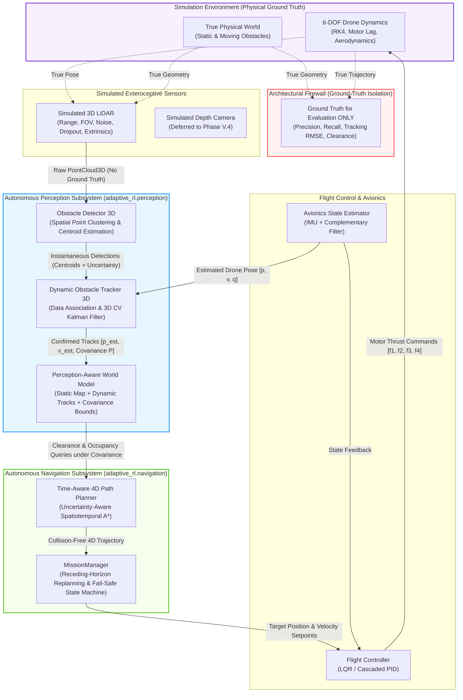
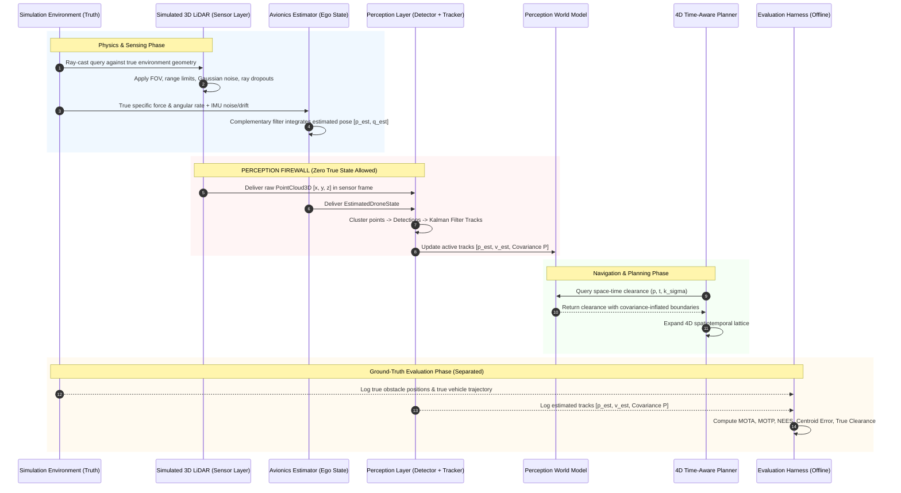
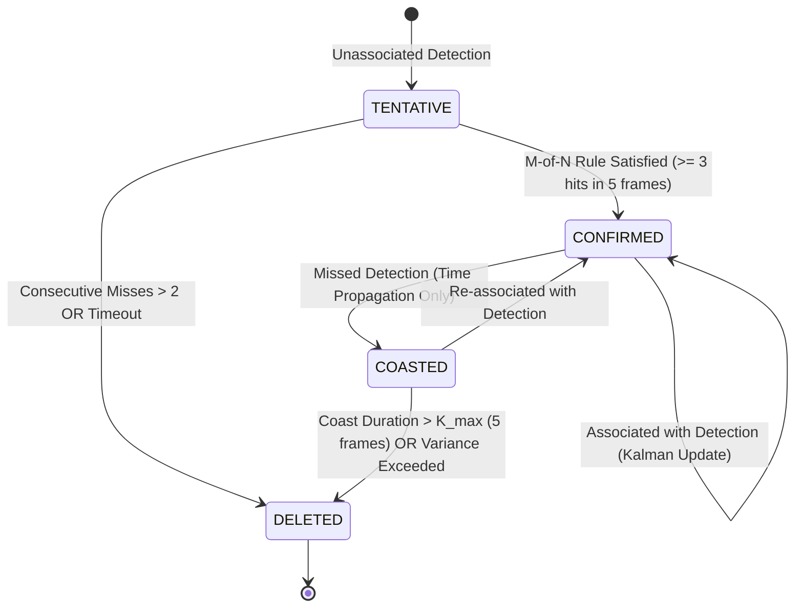
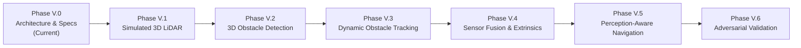

# ARL Phase V.0: Perception-Aware Autonomous Navigation Architecture

## Executive Summary & Mission

AdaptiveRL (ARL) has evolved from kinematic 3D navigation (Phase I/II) to high-fidelity 6-DOF quadrotor dynamics, robust continuous-time LQR control, and sensor-in-the-loop avionics state estimation (Phase III/IV). 

In Phase IV.1, autonomous mission execution and dynamic obstacle avoidance reached a milestone: 4D space-time lattice planning (`TimeAwareAStarPlanner3D`), receding-horizon dynamic replanning (`MissionManager`), and closed-loop feedback driven by noisy avionics state estimation (`IMUSensor` and `ComplementaryFilter`). However, external obstacle avoidance remained completely reliant on direct simulation ground truth: exact analytical equations and positions of static and dynamic obstacles (`ObstacleSphere3D` and `DynamicObstacleSphere3D`) were fed directly from the simulator scenario into the planning engine.

**Phase V establishes the architectural, mathematical, and engineering foundation for Perception-Aware Autonomous Navigation.** 

In Phase V, the quadrotor transitions from navigating via omniscient simulation coordinates to navigating exclusively via uncertain, range-limited, noisy, and potentially occluded exteroceptive sensor observations.



---

## 1. Repository Architecture Audit & Component Inventory

In accordance with Non-Negotiable Engineering Rules 1, 2, and 3, an audit of the current ARL codebase (`origin/feat/phase4-predictive-autonomous-navigation` at commit `763c3da6d2f5e1d2b68730dc862855374b30fda4`) was conducted.

### 1.1 Architecture Inventory & Classification

| Subsystem / Component | Current Implementation Path | Status | Analysis & Role in Phase V |
| :--- | :--- | :--- | :--- |
| **6-DOF Quadrotor Dynamics** | `src/adaptive_rl/environments/drone_6dof.py` | `IMPLEMENTED` | Full rigid-body physics, RK4 integration (5 substeps), quaternion kinematics, motor lag $\tau_{\text{motor}}=0.03\text{ s}$, aerodynamic drag, Cheeseman-Bennett ground effect. Serves as physical ground-truth vehicle simulation. |
| **Drone State Representation** | `DroneState6DOF` in `drone_6dof.py` | `IMPLEMENTED` | Strongly typed dataclass ($p \in \mathbb{R}^3, v \in \mathbb{R}^3, q \in \mathbb{R}^4, \omega \in \mathbb{R}^3$). Scalar-first Hamiltonian quaternion convention. Reused directly across perception and navigation. |
| **Avionics State Estimation** | `IMUSensor` in `sensors/imu.py`<br/>`ComplementaryFilter` in `sensors/estimation.py` | `IMPLEMENTED` | 6-axis IMU (specific force + gyro rate, bias drift) and non-linear SO(3) complementary attitude/position filter. Output `EstimatedDroneState`. Feeds ego-pose into perception tracking and closed-loop flight control. |
| **Static Obstacle Models** | `ObstacleSphere3D` in `environments/drone.py` | `IMPLEMENTED` | Geometric sphere representation ($c \in \mathbb{R}^3, r > 0$). Currently passed directly to planners; in Phase V, restricted to simulation ground-truth and offline validation. |
| **Dynamic Obstacle Models** | `DynamicObstacleSphere3D`<br/>`DivergentDynamicObstacleSphere3D` in `navigation/dynamic_obstacles.py` | `IMPLEMENTED` | Linear reflection ("bounce") and harmonic oscillation moving spheres with analytical bounce-time partitioning and prediction divergence. Serves as ground-truth target motion in simulation. |
| **Static 3D Lattice Planner** | `AStarPlanner3D` in `navigation/planner.py` | `IMPLEMENTED` | 26-connected spatial grid with Euclidean distance heuristic, analytical obstacle inflation, and swept line-of-sight shortcutting. |
| **Time-Aware 4D Path Planner** | `TimeAwareAStarPlanner3D` in `navigation/time_aware_planner.py` | `IMPLEMENTED` | 4D space-time configuration lattice $(x, y, z, t) \in \mathbb{Z}^4$, in-place hover transitions, conservative ceiling time discretization, analytical swept bounding-sphere pre-filtering, and multi-objective route evaluation (`RouteEvaluator`). Will consume `PerceptionWorldModel3D`. |
| **Mission State Machine** | `MissionManager` in `navigation/mission.py` | `IMPLEMENTED` | Receding-horizon clearance monitoring, replanning cooldown hysteresis, off-track deviation triggering, and fail-safe state machine (`IDLE`, `PLANNING`, `EXECUTING`, `WAITING`, `REPLANNING`, `ARRIVED`, `FAILED_BLOCKED`, `ABORTED`). Currently consumes ground truth; will be refactored to consume the perception world model. |
| **Telemetry & Verification** | `FlightScenarioRunner`<br/>`FlightStepTelemetry` in `flight_testing/` | `IMPLEMENTED` | 27 standardized flight scenarios, 8-outcome authoritative taxonomy, cryptographic provenance (`FlightRecord`), continuous analytical clearance evaluation. |
| **Ray-Casting LiDAR Model** | `compute_lidar_3d_readings` in `environments/drone.py` | `PARTIALLY IMPLEMENTED` | 16-ray spherical range-finder with noise and dropout. Used strictly for RL observation vectors in `Drone6DOFEnv`; not modular, lacks point-cloud export, extrinsics, and general exteroceptive perception APIs. |
| **Sensor Abstraction Interface** | `adaptive_rl.perception.sensors` | `IMPLEMENTED` (Phase V.1) | Strongly typed sensor interfaces and concrete `SimulatedLiDAR3D` producing immutable, timestamped `PointCloud3D` observations with zero ground-truth leakage. |
| **3D Obstacle Detection** | `adaptive_rl.perception.detection` | `NOT PRESENT` | Point cloud clustering, centroid estimation, and measurement uncertainty estimation. Planned for Phase V.2. |
| **Dynamic Obstacle Tracking** | `adaptive_rl.perception.tracking` | `NOT PRESENT` | Data association, track persistence, and Kalman state estimation $[p, v, \Sigma]$. Planned for Phase V.3. |
| **Perception World Model** | `adaptive_rl.perception.world_model` | `NOT PRESENT` | Spatial and spatiotemporal occupancy, track management, and covariance-inflated clearance queries. Planned for Phase V.5. |
| **Adversarial Perception Suite**| `tests/test_perception_adversarial.py`| `NOT PRESENT` | Dropout, latency, occlusion, false positives/negatives, and divergence testing. Planned for Phase V.6. |

---

## 2. Information-Flow Boundary & Ground-Truth Isolation

The foundational scientific requirement of Phase V is **Ground-Truth Isolation**:
> The path planner, world model, tracking filters, and flight controllers must never access hidden simulation ground-truth objects (`ObstacleSphere3D`, `DynamicObstacleSphere3D`, or true world obstacles).

### 2.1 The Architectural Firewall



### 2.2 Domain Separation Rules
1. **Simulation Domain (Privileged):**
   - Owns exact physics parameters, ground-truth obstacle trajectories, wind velocity, and true quadrotor state.
   - Generates simulated sensor measurements.
   - Never referenced by planning or decision-making modules.
2. **Autonomous Avionics Domain (Unprivileged):**
   - Receives only raw sensor packets (`PointCloud3D`, `IMUMeasurement`).
   - Receives ego-state estimates only from onboard state estimation (`EstimatedDroneState`).
   - All spatial obstacle representations are generated by perception algorithms.
3. **Evaluation Subsystem (Offline Verification):**
   - The only component permitted to bridge both domains.
   - Compares autonomous avionics estimates against simulation ground truth to calculate scientific performance metrics (localization error, detection precision/recall, track continuity, and true physical clearance).
   - Operates strictly after or parallel to the simulation step; no evaluation metric can feed back into control decisions.

---

## 3. Coordinate Frames, Kinematic Conventions & Transformations

To prevent catastrophic frame-of-reference errors, Phase V strictly adheres to the existing coordinate and rotation standards established in `DroneDynamics6DOF` and `IMUSensor`.

### 3.1 Standard Frame Definitions

| Frame Name | Symbol | Standard Convention | Origin | Axis Directions |
| :--- | :--- | :--- | :--- | :--- |
| **World Frame** | $\mathcal{F}_W$ | **East-North-Up (ENU)** Cartesian | Fixed inertial datum $(0, 0, 0)$ at arena floor | $+X_W$: East<br/>$+Y_W$: North<br/>$+Z_W$: Up (vertical altitude against gravity; floor at $Z=0$) |
| **Body Frame** | $\mathcal{F}_B$ | **Forward-Left-Up (FLU)** Cartesian | Quadrotor Center of Mass (CoM) | $+X_B$: Forward (nose, forward flight heading)<br/>$+Y_B$: Left (port arm direction)<br/>$+Z_B$: Up (normal to rotor plane; collective thrust along $+Z_B$) |
| **Sensor Frame** | $\mathcal{F}_S$ | **Forward-Left-Up (FLU)** Sensor Datum | Optical / mechanical emitter focal center | $+X_S$: Sensor Boresight (pointing forward)<br/>$+Y_S$: Sensor Left<br/>$+Z_S$: Sensor Up |
| **Optical Adapter** | $\mathcal{F}_{\text{opt}}$ | Computer Vision Convention | Camera focal center | $+Z_{\text{opt}}$: Optical axis (forward)<br/>$+X_{\text{opt}}$: Image Right<br/>$+Y_{\text{opt}}$: Image Down |

### 3.2 Attitude & Rotation Representations
- **Attitude Representation:** Unit quaternion $\mathbf{q} = [q_w, q_x, q_y, q_z] \in \mathbb{R}^4$ with scalar-first Hamiltonian convention ($\|\mathbf{q}\|_2 = 1.0$).
- **Rotation Matrix ($R_B^W(\mathbf{q}) \in \mathrm{SO}(3)$):**
  Transforms vectors from the Body Frame $\mathcal{F}_B$ to the World Frame $\mathcal{F}_W$:
  $$\mathbf{v}_W = R_B^W(\mathbf{q}) \mathbf{v}_B$$
  where $R_B^W(\mathbf{q})$ is evaluated via `quaternion_to_rotation_matrix(q)` in `drone_6dof.py`:
  $$R_B^W(\mathbf{q}) = \begin{bmatrix}
  1 - 2(q_y^2 + q_z^2) & 2(q_x q_y - q_w q_z) & 2(q_x q_z + q_w q_y) \\
  2(q_x q_y + q_w q_z) & 1 - 2(q_x^2 + q_z^2) & 2(q_y q_z - q_w q_x) \\
  2(q_x q_z - q_w q_y) & 2(q_y q_z + q_w q_x) & 1 - 2(q_x^2 + q_y^2)
  \end{bmatrix}$$
- **Inverse Transformation:** Since $R \in \mathrm{SO}(3)$, the world-to-body mapping is the matrix transpose:
  $$\mathbf{v}_B = (R_B^W)^T \mathbf{v}_W = R_W^B \mathbf{v}_W$$

### 3.3 Sensor Extrinsics & Transformation Pipeline
A range sensor mounted on the quadrotor airframe is parameterized by its rigid-body extrinsic calibration:
- Translation vector: $\mathbf{p}_S^B = [x_{\text{mount}}, y_{\text{mount}}, z_{\text{mount}}]^T \in \mathbb{R}^3$ (position of sensor relative to vehicle CoM in body frame).
- Rotation matrix: $R_S^B \in \mathrm{SO}(3)$ (orientation of sensor relative to body frame).

For any 3D point $\mathbf{p}_S = [x_s, y_s, z_s]^T$ observed in the sensor frame at timestamp $t$:
1. **Sensor to Body Transformation:**
   $$\mathbf{p}_B = \mathbf{p}_S^B + R_S^B \mathbf{p}_S$$
2. **Body to World Transformation:**
   $$\mathbf{p}_W(t) = \hat{\mathbf{p}}_B^W(t) + R_B^W(\hat{\mathbf{q}}(t)) \mathbf{p}_B$$
   where $\hat{\mathbf{p}}_B^W(t)$ and $\hat{\mathbf{q}}(t)$ are the estimated position and attitude quaternion supplied by the onboard avionics estimator (`EstimatedDroneState`).

### 3.4 Temporal Synchronization & Latency
- Simulation runs on master discrete time $t_{\text{sim}} = k \cdot \Delta t_{\text{sim}}$ with $\Delta t_{\text{sim}} = 0.05\text{ s}$ ($20\text{ Hz}$).
- Sensors operate with configurable update period $\Delta t_{\text{sensor}}$ (e.g. $10\text{ Hz}$ or $20\text{ Hz}$).
- Sensor latency $\tau_{\text{latency}}$ models transmission and processing delays. When point cloud data arrives at $t_{\text{arrival}} = t_{\text{meas}} + \tau_{\text{latency}}$, the transformation pipeline queries the vehicle pose history buffer at epoch $t_{\text{meas}}$ to perform motion-compensated spatial projection, preventing rotational smearing.

---

## 4. Sensor Abstraction Layer & Data Contracts

### 4.1 Sensor Prioritization: 3D LiDAR First
ARL Phase V selects a **Simulated 3D Scanning LiDAR** as the primary exteroceptive sensor, deferring Depth Cameras to Phase V.4:
1. **Direct Spatial Geometry:** LiDAR produces Cartesian coordinate point clouds $[x, y, z]$ directly, requiring no camera pinhole projection matrices, lens distortion inversion, or dense pixel de-projection.
2. **Computational Performance in Pure Python/NumPy:** A 3D multi-beam LiDAR sweep of 64–256 rays can be evaluated analytically via vectorized ray-sphere/ray-box intersections in $< 5\text{ ms}$, preserving high simulation frame rates ($> 100\text{ Hz}$). Simulating a VGA depth frame ($640 \times 480 = 307{,}200$ pixels) in pure Python without dedicated GPU rasterization would bottleneck execution.
3. **Low-Dependency Mandate:** Spatial point-cloud filtering and clustering can be implemented cleanly with `numpy` and `scipy.spatial` (KD-tree nearest neighbor searches), adhering strictly to Rule 4.

### 4.2 Strongly Typed Data Contracts (`adaptive_rl.perception.sensors`)

> [!IMPORTANT]
> The data contracts specified below are **ARCHITECTURAL SPECIFICATIONS** for implementation in Phase V.1 (`adaptive_rl.perception.sensors`). They are not present in the Phase V.0 repository.

```python
from __future__ import annotations
from dataclasses import dataclass
from enum import Enum
from typing import Any, Dict, List, Optional, Tuple
import numpy as np

@dataclass(frozen=True)
class SensorExtrinsics:
    """Rigid-body pose of the sensor relative to the vehicle body frame (FLU)."""
    translation_b: np.ndarray       # [x, y, z] in meters relative to CoM
    rotation_s_to_b: np.ndarray     # 3x3 orthonormal rotation matrix R_S^B (maps v_S to v_B = R_S^B * v_S)

    def to_dict(self) -> Dict[str, Any]:
        return {
            "translation_b": [round(float(x), 4) for x in self.translation_b],
            "rotation_s_to_b": [[round(float(c), 4) for c in row] for row in self.rotation_s_to_b],
        }

@dataclass(frozen=True)
class SensorConfig3D:
    """Configuration parameters for 3D range-sensing exteroceptive sensors."""
    sensor_id: str = "lidar_primary"
    update_rate_hz: float = 20.0
    min_range_m: float = 0.2
    max_range_m: float = 25.0
    horizontal_fov_deg: float = 360.0    # Omnidirectional azimuth or forward sector
    vertical_fov_deg: float = 60.0        # Elevation span [-30 deg, +30 deg]
    horizontal_beams: int = 32           # Azimuth rays
    vertical_beams: int = 8              # Elevation layers
    range_noise_std_m: float = 0.03      # Zero-mean Gaussian range error
    dropout_probability: float = 0.02    # Statistical beam loss (dust, absorption)
    latency_sec: float = 0.02            # Sensor readout and transport latency
    extrinsics: Optional[SensorExtrinsics] = None

@dataclass(frozen=True)
class PointCloud3D:
    """Immutable point cloud observation generated by a 3D range sensor."""
    timestamp: float                    # Measurement epoch in simulation seconds
    frame_id: str                       # Coordinate frame ("sensor", "body", "world")
    points: np.ndarray                  # (N, 3) float64 Cartesian coordinates [x, y, z]
    ranges: np.ndarray                  # (N,) float32 measured radial distances
    valid_mask: np.ndarray              # (N,) bool array (True = valid echo, False = dropped/out-of-range)
    sensor_id: str
    extrinsics: SensorExtrinsics
    sensor_origin_w: Optional[np.ndarray] = None # Sensor position in world frame at capture
```

#### Array Immutability, Defensive Copying, Geometric Consistency & Validation
In Python, `@dataclass(frozen=True)` prevents attribute reassignment (`obj.points = ...`), but **does not make the underlying NumPy array buffers read-only** (`obj.points[0, 0] = ...` would silently mutate memory).
To enforce strict scientific data integrity in Phase V.1 / V.1.1 implementations:
- **Read-Only Buffers:** Constructors explicitly set `flags.writeable = False` on `points`, `ranges`, `valid_mask`, `intensities`, `sensor_origin_w`, and extrinsics buffers.
- **Defensive Ingestion:** All array parameters are copied on ingestion (`np.array(arr, copy=True)`).
- **Canonical Invalid Return Contract:** Dropped or out-of-range returns (`valid_mask == False`) MUST report `[NaN, NaN, NaN]` coordinates, `NaN` range, and `0.0` intensity. They are **never** silently converted to `0.0 m` or `max_range`.
- **Geometric Point-to-Range Consistency:** Valid returns (`valid_mask == True`) must satisfy $|\|\mathbf{p}_i - \mathbf{o}_{\text{frame}}\|_2 - r_i| \le 10^{-3}\text{ m}$ against the frame-specific sensor origin ($\mathbf{0}$ in sensor frame, $\mathbf{t}_B$ in body frame, $\text{sensor\_origin\_w}$ in world frame).
- **SO(3) Rotation Validation:** All rotation matrices are verified for orthonormality ($\|R R^T - I_3\|_2 \le 10^{-5}$) and proper rotation determinant ($|\det(R) - 1.0| \le 10^{-4}$), rejecting reflections ($\det=-1$), scaling, and non-finite values.
- **Timing & Latency Semantics:** Capture timing is caller-managed (`timestamp` is $t_{\text{meas}}$). Configured latency (`latency_sec`) specifies avionics budget; asynchronous delivery queues are deferred to Phase V.4.

---

## 5. 3D Obstacle Detection Representation

A sensor point cloud contains individual spatial returns, not semantic objects. The detection layer processes raw point clouds into discrete candidate obstacle instances.

```python
@dataclass(frozen=True)
class ObstacleDetection3D:
    """Instantaneous spatial obstacle detection produced by clustering algorithms."""
    detection_id: str                   # Ephemeral UUID for this observation frame
    timestamp: float                    # Capture timestamp in simulation seconds
    frame_id: str                       # Coordinate frame (strictly "world" after projection)
    centroid: np.ndarray                # [x, y, z] estimated cluster center in meters
    bounding_radius: float              # Enclosing spherical radius in meters
    covariance_position: np.ndarray     # (3, 3) spatial covariance matrix Sigma_pos
    point_count: int                    # Number of point returns supporting this cluster
    confidence: float                   # Detection confidence score in [0.0, 1.0]
    sensor_id: str                      # Originating sensor
    is_valid: bool = True               # Validity flag (rejected if non-finite coordinates)
```

### 5.1 Physical Extent, Measurement Noise, and Surface Dispersion
A critical scientific error is assuming that the spatial dispersion of detected points is identical to sensor measurement noise. In Phase V, the detection layer strictly distinguishes five distinct physical and geometric quantities:

1. **Physical Obstacle Extent:** The true volumetric geometry of the obstacle (e.g. solid sphere of radius $r^*$ or bounding box).
2. **Visible Surface Dispersion ($\Sigma_{\text{surface}}$):** LiDAR rays do not penetrate obstacles; they reflect exclusively from the front-facing exterior surface manifold. The sample dispersion matrix:
   $$\Sigma_{\text{surface}} = \frac{1}{N-1} \sum_{i=1}^N (\mathbf{p}_i - \bar{\mathbf{p}})(\mathbf{p}_i - \bar{\mathbf{p}})^T$$
   measures the **geometric shape and curvature of the visible surface patch**, NOT sensor measurement error.
3. **LiDAR Range Measurement Noise in Cartesian Space:**
   Each beam measures radial distance $r_i$ along unit direction vector $\mathbf{u}_i = [\cos\phi_i \cos\theta_i, \cos\phi_i \sin\theta_i, \sin\phi_i]^T$ with radial standard deviation $\sigma_r$ and angular beam pointing noise $\sigma_{\text{beam}}$.
   The 3D Cartesian measurement covariance for each individual return point is:
   $$\Sigma_{\mathbf{p}_i} = \sigma_r^2 \mathbf{u}_i \mathbf{u}_i^T + (r_i \sigma_{\text{beam}})^2 (I - \mathbf{u}_i \mathbf{u}_i^T)$$
   Because $\sigma_r \gg r_i \sigma_{\text{beam}}$ for high-accuracy pulsed LiDAR, measurement uncertainty is highly anisotropic, dominated along the line-of-sight ray axis $\mathbf{u}_i$.
4. **Centroid Estimation Bias under Partial Observation:**
   Because the sensor observes only the facing hemisphere, the naive sample mean $\bar{\mathbf{p}} = \frac{1}{N} \sum_{i=1}^N \mathbf{p}_i$ is **systematically biased toward the sensor** relative to the true volumetric center $\mathbf{c}^*$. For a sphere of radius $r$, the centroid of a uniform hemisphere lies at distance $\frac{1}{2} r$ from the true center along the viewing ray:
   $$\mathbf{c}^* \approx \bar{\mathbf{p}} + \frac{1}{2} r^* \mathbf{u}_{\text{view}}$$
   Using $\bar{\mathbf{p}}$ without depth correction places the estimated obstacle center too close to the quadrotor.
5. **Occlusion & Conservative Bounding Geometry:**
   The rear side of an obstacle is unobserved. Bounding radius $\hat{r} = \max_i \|\mathbf{p}_i - \bar{\mathbf{p}}\|$ measures only the visible surface chord and underestimates full physical extent. In Phase V.2, obstacle bounding must fit a parametric spherical surface model $\min_{\mathbf{c}, r} \sum_i (\|\mathbf{p}_i - \mathbf{c}\| - r)^2$ or enforce a conservative depth inflation margin $\hat{r}_{\text{conservative}} = \hat{r} + \delta_{\text{depth}}$.

> [!NOTE]
> **Open Design Questions for Phase V.2:**
> 1. Optimal numerical solver for non-linear sphere fitting under sparse beam returns ($N < 8$ points per obstacle).
> 2. Analytical propagation of spherical surface-fit residuals into the $3 \times 3$ centroid covariance matrix $R$.

---

## 6. Dynamic Obstacle Tracking Subsystem

Instantaneous detections cannot be passed directly to the trajectory planner. An instantaneous detection:
- Provides no velocity vector.
- May be a transient false-positive.
- Disappears during momentary sensor occlusions or dropouts.

The **Dynamic Obstacle Tracker** (`DynamicObstacleTracker3D`) bridges instantaneous detections into persistent spatiotemporal tracks.

### 6.1 Track Lifecycle State Machine



### 6.2 3D Constant Velocity (CV) Kalman Filter Specification
Each active track maintains a 6-dimensional state vector $\mathbf{x} \in \mathbb{R}^6$ and $6 \times 6$ error covariance matrix $P$:
$$\mathbf{x} = \begin{bmatrix} x & y & z & v_x & v_y & v_z \end{bmatrix}^T = \begin{bmatrix} \mathbf{p} \\ \mathbf{v} \end{bmatrix}$$

#### A. Motion Prediction Step (Time Update)
Propagating from timestamp $t_{k-1}$ to $t_k$ over interval $\Delta t = t_k - t_{k-1}$:
$$\hat{\mathbf{x}}_{k|k-1} = F(\Delta t) \hat{\mathbf{x}}_{k-1|k-1}$$
$$P_{k|k-1} = F(\Delta t) P_{k-1|k-1} F(\Delta t)^T + Q(\Delta t)$$

Where the transition matrix $F(\Delta t)$ and discrete process noise matrix $Q(\Delta t)$ under continuous white-noise acceleration $q_{\text{accel}}$ are:
$$F(\Delta t) = \begin{bmatrix} I_{3 \times 3} & \Delta t \cdot I_{3 \times 3} \\ 0_{3 \times 3} & I_{3 \times 3} \end{bmatrix}$$
$$Q(\Delta t) = q_{\text{accel}} \begin{bmatrix} \frac{\Delta t^3}{3} I_{3 \times 3} & \frac{\Delta t^2}{2} I_{3 \times 3} \\ \frac{\Delta t^2}{2} I_{3 \times 3} & \Delta t \cdot I_{3 \times 3} \end{bmatrix}$$

#### B. Measurement Model
The detector observes spatial centroids $\mathbf{z}_k = [x_m, y_m, z_m]^T \in \mathbb{R}^3$:
$$\mathbf{z}_k = H \mathbf{x}_k + \boldsymbol{\eta}_k, \quad \boldsymbol{\eta}_k \sim \mathcal{N}(\mathbf{0}, R_k)$$
$$H = \begin{bmatrix} I_{3 \times 3} & 0_{3 \times 3} \end{bmatrix} \in \mathbb{R}^{3 \times 6}$$

#### C. Data Association & Gating
For each candidate pair of track $i$ and detection $j$:
1. **Innovation Vector & Innovation Covariance:**
   $$\mathbf{y}_{ij} = \mathbf{z}_j - H \hat{\mathbf{x}}_{i, k|k-1}$$
   $$S_{ij} = H P_{i, k|k-1} H^T + R_j \in \mathbb{R}^{3 \times 3}$$
2. **Mahalanobis Distance Gating:**
   $$d_{M, ij}^2 = \mathbf{y}_{ij}^T S_{ij}^{-1} \mathbf{y}_{ij}$$
   A pair is gated out if $d_{M, ij}^2 > \gamma_{\text{gate}}$, where $\gamma_{\text{gate}} = \chi^2_3(0.99) \approx 11.34$.
3. **Global Association:**
   The gated cost matrix $C_{ij} = d_{M, ij}^2$ is solved globally using the Hungarian algorithm (`scipy.optimize.linear_sum_assignment`), guaranteeing globally optimal assignment without greedy race conditions.

#### D. Measurement Correction Step (Information Update)
For each associated track:
$$K_k = P_{k|k-1} H^T S_k^{-1} \in \mathbb{R}^{6 \times 3}$$
$$\hat{\mathbf{x}}_{k|k} = \hat{\mathbf{x}}_{k|k-1} + K_k \mathbf{y}_k$$
To ensure numerical symmetry and positive semi-definiteness, covariance is updated via the **Joseph stabilized formulation**:
$$P_{k|k} = (I - K_k H) P_{k|k-1} (I - K_k H)^T + K_k R_k K_k^T$$

---

## 7. Uncertainty Representation & Covariance-Aware Planning

Uncertainty must directly inform path planning. If an obstacle has high velocity dispersion or has been coasted without observation, the navigation system must defensively maintain wider separation.

### 7.1 Forward Uncertainty Propagation
When the planner evaluates trajectory clearance over lookahead horizon $\tau = t_{\text{eval}} - t_{\text{curr}} > 0$:
The spatial position covariance $\Sigma_p(t + \tau)$ propagates analytically as:
$$\Sigma_p(t + \tau) = \Sigma_p(t) + \tau \left(\Sigma_{pv}(t) + \Sigma_{pv}(t)^T\right) + \tau^2 \Sigma_v(t) + \frac{\tau^3}{3} q_{\text{accel}} I_{3 \times 3}$$

Key mathematical properties:
- **Velocity Uncertainty Amplification:** Uncertainty grows quadratically with velocity variance ($\tau^2 \Sigma_v$).
- **Coasting Growth:** If observations cease, covariance grows monotonically, forcing the planner to increase clearance.

### 7.2 Isotropic Bounding Sphere Formulation
To evaluate continuous swept clearance across thousands of candidate 4D lattice edges in milliseconds, the 3D confidence ellipsoid is conservatively bounded by an isotropic bounding sphere derived from its spectral radius:
$$\sigma_{\max}(\tau) = \sqrt{\lambda_{\max}(\Sigma_p(t + \tau))}$$

**Perception-Aware Effective Obstacle Radius:**
$$r_{\text{effective}}(t + \tau) = \hat{r}_{\text{obs}} + r_{\text{vehicle}} + \delta_{\text{nominal}} + k_{\sigma} \cdot \sigma_{\max}(\tau)$$
where:
- $\hat{r}_{\text{obs}}$: Estimated physical obstacle radius.
- $r_{\text{vehicle}} = 0.25\text{ m}$: Bounding radius of the quadrotor.
- $\delta_{\text{nominal}} = 0.15\text{ m}$: Base aerodynamic/control margin.
- $k_{\sigma}$: Confidence scaling multiplier derived from Chi-squared distribution $\chi^2_3$.
  For 3D position error $\tilde{\mathbf{p}} \sim \mathcal{N}(\mathbf{0}, \Sigma_p)$, the squared Mahalanobis distance $\epsilon = \tilde{\mathbf{p}}^T \Sigma_p^{-1} \tilde{\mathbf{p}}$ follows a $\chi^2_3$ distribution. The containment probability $P$ inside the ellipsoid $\epsilon \le k_{\sigma}^2$ is:
  $$P(\epsilon \le k_{\sigma}^2) = F_{\chi^2_3}(k_{\sigma}^2) = 2 \Phi(k_{\sigma}) - 1 - \sqrt{\frac{2}{\pi}} k_{\sigma} e^{-k_{\sigma}^2 / 2}$$
  Evaluating this:
  - $k_{\sigma} = 3.0$ yields $F_{\chi^2_3}(9.0) \approx 0.9707$ ($97.07\%$ containment, not $98.9\%$, which is the 2D value $1 - e^{-4.5}$).
  - For $95\%$ containment: $k_{\sigma} = \sqrt{\chi^2_3(0.95)} = \sqrt{7.8147} \approx 2.795$.
  - For $99\%$ containment: $k_{\sigma} = \sqrt{\chi^2_3(0.99)} = \sqrt{11.3449} \approx 3.368$.
  Default configuration adopts $k_{\sigma} = 3.0$ ($97.07\%$ containment) with $k_{\sigma} = 3.37$ ($99.0\%$ containment) available for tight corridors.

```text
       True Physical Obstacle:   [  Radius r_obs  ]
       Vehicle Body Margin:      [ + r_vehicle ]
       Baseline Safety Margin:   [ + delta_nom ]
       Uncertainty Inflation:    [ + k_sigma * sqrt(lambda_max(Sigma_p(t+tau))) ]
       -------------------------------------------------------------------------
       Total Effective Radius:   ==================> r_effective(t+tau)
```

---

## 8. Perception-Aware World Model & Planner Integration

### 8.1 Abstract World Model Interface (`WorldModelInterface`)

The interface decouples motion planners from the perception subsystem:

```python
from abc import ABC, abstractmethod
from typing import Sequence, Tuple

class WorldModelInterface(ABC):
    """Abstract spatial and spatiotemporal environment interface for path planners."""

    @abstractmethod
    def query_clearance(
        self,
        position: np.ndarray,
        time_sec: float,
        vehicle_radius: float = 0.25,
        confidence_k: float = 3.0,
    ) -> float:
        """Calculate signed minimum distance to nearest obstacle boundary at time_sec.
        Returns positive when clear, negative when intersecting.
        """
        pass

    @abstractmethod
    def is_transition_valid(
        self,
        p_start: np.ndarray,
        p_end: np.ndarray,
        t_start: float,
        t_end: float,
        vehicle_radius: float = 0.25,
        confidence_k: float = 3.0,
    ) -> Tuple[bool, float]:
        """Continuous swept clearance check across space-time segment [p_start, p_end].
        Returns:
            (is_valid, min_clearance_along_segment)
        """
        pass

    @abstractmethod
    def query_occupancy(
        self,
        position: np.ndarray,
        time_sec: float,
    ) -> str:
        """Classify spatial point as 'free', 'occupied', or 'unknown'."""
        pass
```

### 8.2 Planner Integration Architecture
- `PerceptionWorldModel3D` implements `WorldModelInterface` for production perception-aware navigation, fed by active tracks and static background maps.
- `GroundTruthWorldModelAdapter` implements `WorldModelInterface` wrapping legacy `ObstacleSphere3D` and `DynamicObstacleSphere3D` lists, preserving 100% backward compatibility for all Phase III/IV regression tests.
- `TimeAwareAStarPlanner3D` and `MissionManager` are refactored to query `WorldModelInterface`, achieving total isolation from simulator internals.

---

## 9. Safety, Fail-Safe Behavior & Unknown-Space Policy

### 9.1 Authoritative Perception Fail-Safe Decision Table & Localization Decoupling
The perception subsystem establishes a deterministic, hierarchical response to sensor, estimator, and environmental anomalies. It strictly distinguishes high-level mission state management (`MissionManager`) from low-level autopilot flight safety actions (`FlightController`).

The following decision table serves as the **Single Authoritative Source of Truth** for all failure modes across the ARL autonomy stack:

| Failure Mode | Observable State Variables | Remaining Control Capabilities | Required Mission State Transition | Permitted Low-Level Flight Response | Prohibited Response | Required Telemetry | Recovery Conditions | Timeout / Unresolved Dependency | Validation Scenario |
| :--- | :--- | :--- | :--- | :--- | :--- | :--- | :--- | :--- | :--- |
| **1. Brief Exteroceptive Dropout** | Full ego-motion $[\mathbf{p}, \mathbf{v}, \mathbf{q}, \boldsymbol{\omega}]$ healthy | Full 3D position hold, velocity damping, attitude control | Maintain `EXECUTING` | Coast active tracks forward via Kalman filter; inflate spatial covariance $\Sigma_p(t)$; enforce delay-aware braking horizon speed limit | **PROHIBITED** to abort abruptly; **PROHIBITED** to accelerate forward | `failsafe_event: "brief_dropout"`, `dropout_duration_sec` | Sensor frame received within $\Delta t \le 0.30\text{ s}$ with valid timestamps | $\Delta t \le 0.30\text{ s}$ ($\le 6$ steps at 20 Hz) | Scenario P07 |
| **2. Sustained Exteroceptive Dropout** | Full ego-motion $[\mathbf{p}, \mathbf{v}, \mathbf{q}, \boldsymbol{\omega}]$ healthy | Full 3D position hold, velocity damping, attitude control | `EXECUTING` $\to$ `WAITING` | Freeze forward path progression; command $\mathbf{v}_{\text{cmd}} = \mathbf{0}$, $\mathbf{p}_{\text{cmd}} = \mathbf{p}_{\text{hold}}$. **Stationary hover hold is physically feasible.** | **PROHIBITED** to continue forward flight into unobserved space; **PROHIBITED** to hover indefinitely | `failsafe_event: "sustained_dropout"`, `hover_hold_engaged: True` | Sensor stream restored within $2.0\text{ s}$ with verified corridor clearance | $0.30\text{ s} < \Delta t \le 2.0\text{ s}$; bounded by battery reserve | Scenario P07 |
| **3. Terminal Exteroceptive Outage** | Full ego-motion $[\mathbf{p}, \mathbf{v}, \mathbf{q}, \boldsymbol{\omega}]$ healthy | Full 3D position hold, velocity damping, attitude control | `WAITING` $\to$ `FAILED_BLOCKED` | Terminate mission. If verified obstacle-free landing corridor exists, command controlled descent ($v_z = -0.5\text{ m/s}$); otherwise hold hover until battery limit | **PROHIBITED** to plan new paths; **PROHIBITED** to execute blind high-speed return-to-base | `failsafe_event: "terminal_sensor_outage"`, `descent_engaged: bool` | Ground intervention and manual sensor reset | Outage exceeds $T_{\text{outage}} = 2.0\text{ s}$; battery reserve limit | Scenario P07 |
| **4. Loss of Horizontal Position Aiding** | Altitude $z$, vertical velocity $v_z$, attitude $\mathbf{q}$, angular velocity $\boldsymbol{\omega}$. Horizontal position $\mathbf{p}_{xy}$ is **UNOBSERVABLE** | Altitude hold, attitude stabilization, short-term horizontal velocity damping. **Position hold is IMPOSSIBLE.** | `EXECUTING` $\to$ `WAITING` $\to$ `FAILED_BLOCKED` | Command zero velocity setpoint $\mathbf{v}_{\text{cmd}, xy} = \mathbf{0}$ to damp translation kinetic energy. If unaided $> 3.0\text{ s}$, initiate controlled descent | **PROHIBITED TO CLAIM STATIONARY HOVER.** Vehicle drifts open-loop with wind and aerodynamic trim imbalances | `failsafe_event: "horizontal_aiding_loss"`, `drift_rate_est`, `unaided_sec` | Horizontal position aiding restored ($\sigma_{xy} < 1.0\text{ m}$) within $3.0\text{ s}$ | $T_{\text{unaided}} = 3.0\text{ s}$ (`PROVISIONAL TARGET`) | Scenario P11 (provisional) |
| **5. Loss of Altitude Aiding** | Horizontal position $\mathbf{p}_{xy}$, velocity $\mathbf{v}_{xy}$, attitude $\mathbf{q}$. Altitude $z$ and vertical velocity $v_z$ are **UNOBSERVABLE** | Horizontal position hold and attitude control. **Vertical rate/position closed loop is UNAVAILABLE.** | `EXECUTING` $\to$ `FAILED_BLOCKED` | Hold horizontal position; command collective thrust ramp to sub-hover thrust ($T \approx 0.90 mg$) for open-loop settling descent | **PROHIBITED TO CLAIM GUARANTEED VERTICAL DESCENT RATE** (e.g. claiming exact $-0.5\text{ m/s}$ when $v_z$ is unobservable) | `failsafe_event: "altitude_aiding_loss"`, `raw_baro_health: "fault"` | Backup rangefinder/altimeter acquisition within $1.5\text{ s}$ | $2.0\text{ s}$ maximum before ground impact mitigation | Scenario P12 (provisional) |
| **6. Loss of Velocity Observability** | Attitude $\mathbf{q}$ (gravimetric leveling) and angular rates $\boldsymbol{\omega}$ only. Position and velocity are **UNOBSERVABLE** | Attitude stabilization ($\phi = \theta = 0$, rate damping) only. **Neither position hold nor velocity damping is feasible.** | `EXECUTING` $\to$ `FAILED_BLOCKED` | Level airframe wings ($\phi_{\text{cmd}} = \theta_{\text{cmd}} = 0$); command sub-hover descent thrust ($T \approx 0.85 mg$) to settle immediately | **PROHIBITED TO CLAIM STATIONARY HOVER OR SAFE COLLISION AVOIDANCE** | `failsafe_event: "velocity_unobservable"` | Velocity observability restored ($\sigma_v < 0.5\text{ m/s}$) | $1.0\text{ s}$ (`PROVISIONAL TARGET`) | Scenario P13 (provisional) |
| **7. Attitude Estimator Failure** | **NONE.** Vehicle orientation cannot be determined | **ZERO.** Quadrotor cannot maintain torque balance or point thrust vector | Transition immediately to `ABORTED` | `NO VALIDATED SAFE ACTION SPECIFIED — SYSTEM CAPABILITY LIMITATION` | **PROHIBITED to claim safe hover, controlled descent, or motor disarm as safe. PROHIBITED to claim autorotation.** | `failsafe_event: "attitude_estimator_crash"`, `quaternion_health: "corrupted"` | None airborne; ground power-cycle only | Immediate ($0.0\text{ s}$) | Scenario P14 (provisional) |
| **8. Complete Localization Failure** | **NONE** from software state estimator | Software stack has zero flight control capability | Transition immediately to `ABORTED` | `NO VALIDATED SAFE ACTION SPECIFIED — SYSTEM CAPABILITY LIMITATION` | **PROHIBITED to claim controlled flight, safe landing, or safe hover** | `failsafe_event: "total_localization_failure"` | None airborne | Immediate ($0.0\text{ s}$) | Scenario P15 (provisional) |
| **9. Battery Reserve Violation** | All flight sensors and state estimators $[\mathbf{p}, \mathbf{v}, \mathbf{q}, \boldsymbol{\omega}]$ healthy; battery telemetry active | Full flight control available, but flight time is strictly finite ($t_{\text{remaining}} \le t_{\text{land}}$) | `EXECUTING` or `WAITING` $\to$ `FAILED_BLOCKED` | Inhibit further waiting or exploration; command immediate direct vertical descent or shortest-path return-to-base (RTB) | **PROHIBITED TO MAINTAIN INDEFINITE HOVER.** Hover consumes peak power, causing BMS low-voltage cutoff and uncontrolled crash | `failsafe_event: "battery_reserve_violation"`, `remaining_soc_pct`, `time_to_depletion_sec` | Ground landing and recharge only | Dynamic battery reserve threshold ($\text{SoC} \le 20\%$ or $t_{\text{reserve}} \le 60\text{ s}$) | Scenario P16 (provisional) |
| **10. Operator Communication Loss** | All onboard flight sensors and autonomy state estimators healthy | Full onboard autonomous navigation and flight control available | Autonomous contingency (`EXECUTING` or `WAITING` $\to$ `FAILED_BLOCKED`) | Continue pre-planned route if verified obstacle-free; if path blocked, enter bounded `WAITING` ($t \le 5.0\text{ s}$), then execute autonomous back-tracking to last comms link or vertical descent | **PROHIBITED to drift unbounded or terminate flight prematurely when onboard autonomy is healthy** | `failsafe_event: "c2_link_loss"`, `autonomous_contingency_active: True` | Datalink re-establishment with valid heartbeat within timeout | $T_{\text{c2\_timeout}} = 5.0\text{ s}$ (`PROVISIONAL TARGET`) | Scenario P17 (provisional) |
| **11. Covariance Anomaly (ADR-005)** | Sensor and state estimates valid; covariance exhibiting numerical defect | Vehicle retains full flight control; tracking pipeline updates affected | Maintain state, or trigger `REPLANNING` / `WAITING` if track purged | Apply Joseph stabilization; symmetrize $P_z$; clamp tiny eigenvalues ($-10^{-7} \le \lambda < 0$); purge divergent tracks ($\lambda_{\min} < -10^{-7}$) | **PROHIBITED to use Joseph form as automatic repair for non-finite or diverged matrices** | `covariance_health: "symmetrized" \| "eigen_clamped" \| "divergent_invalidated"` | Filter reinitialization or fresh track acquisition | 1 frame update | Scenario P09 |
| **12. Non-Finite Sensor Data** | Localization healthy; sensor returns contain NaN or Inf values | Full flight control available | Maintain state; if corrupted frames persist $> 3$ frames $\to$ `ABORTED` | Drop corrupted points; flag `valid_mask = False` | **PROHIBITED to map invalid returns to $0.0\text{ m}$ (phantom obstacle) or `max_range` (obstacle masking)** | `failsafe_event: "corrupted_sensor_frame"` | Clean finite frame received within 3 consecutive frames | 3 consecutive frames ($0.15\text{ s}$) | Scenario P09 |
| **13. Excessive Track Uncertainty** | Localization healthy; track position uncertainty $\sigma_{\max} > 2.5\text{ m}$ | Full flight control available | Trigger `REPLANNING`; if blocked $\to$ `WAITING` | Treat track as large spatial exclusion sphere ($r_{\text{eff}} = \hat{r}_{\text{obs}} + 2.5\text{ m}$); trigger dynamic replan | **PROHIBITED to fly through high-uncertainty corridor** | `failsafe_event: "excessive_track_uncertainty"`, `track_id`, `sigma_max` | Track uncertainty reduces below $2.5\text{ m}$ via fresh measurements | Bounded by waiting timeout ($5.0\text{ s}$) | Scenario P03 |
| **14. Stale Track Stagnation** | Localization healthy; track unobserved for $> K_{\text{max\_coast}}$ (5 frames) | Full flight control available | Re-evaluate world model clearance | Purge track from active memory; clear associated world-model exclusion volume | **PROHIBITED to propagate unobserved tracks indefinitely without covariance inflation** | `failsafe_event: "stale_track_purged"`, `track_id` | New detection re-initiates track lifecycle | 5 frames ($0.25\text{ s}$) | Scenario P07 |

---

### 9.1.1 Critical Prerequisites for Emergency Controlled Descent
In an unmapped or obstacle-rich flight arena, commanding vertical descent without active exteroceptive sensing carries inherent collision risk with obstacles directly beneath the airframe. The autonomy stack strictly distinguishes four descent regimes:

1. **Verified Corridor Descent (Nominal Fail-Safe):**
   - **Prerequisites:** A verified obstacle-free vertical corridor was logged prior to sensor loss, downward rangefinder sensing is operational, and altitude/velocity estimation is healthy.
   - **Action:** Execute controlled constant-rate vertical descent ($v_z = -0.5\text{ m/s}$) to landing.
2. **Unverified Terrain Descent (High-Risk Fail-Safe of Last Resort):**
   - **Prerequisites:** Exteroceptive sensing is lost, terrain beneath the aircraft is unmapped, but vehicle localization and attitude control remain healthy.
   - **Action:** Bounded emergency descent executed strictly to prevent unbounded horizontal drift, arena wall breach, or battery exhaustion. This action is classified as a **High-Risk Emergency Action**, *not* a guaranteed safe landing.
3. **Loss of Altitude Observability Descent:**
   - **Prerequisites:** Barometer/altimeter failed; vertical state $z, v_z$ unobservable.
   - **Action:** Closed-loop rate control is impossible. Command a feedforward sub-hover collective thrust ramp ($T \approx 0.90 mg$) to settle gently without tumbling.
4. **Loss of Attitude Control:**
   - **Prerequisites:** Attitude estimator crashed or quaternion non-finite.
   - **Action:** Controlled descent is **physically impossible**. Quadrotor will tumble; cannot be recovered by software.

### 9.1.2 Battery Reserve Dependency & Bounded Waiting Policy
A multicopter in stationary hover consumes near-peak electrical power ($P_{\text{hover}} \approx 150\text{--}250\text{ W}$ for typical 1 kg quadrotors), rapidly depleting onboard battery reserves.
- **Indefinite Hover Prohibition:** Under no circumstances may the aircraft remain in `WAITING` (hover hold) indefinitely. Hovering until total battery exhaustion triggers battery management system (BMS) low-voltage shutdown, resulting in motor cut-off and an uncontrolled free-fall crash.
- **Bounded Waiting Timeout:** The duration of any `WAITING` state is strictly bounded by:
  $$t_{\text{wait}} \le \min\left(t_{\text{max\_wait}}, \; t_{\text{battery\_reserve}}\right)$$
  where:
  - $t_{\text{max\_wait}} = 5.0\text{ s}$: `PROVISIONAL TARGET` (engineering timeout for obstacle clearance or sensor recovery).
  - $t_{\text{battery\_reserve}}$: Dynamic estimate of remaining flight time before reaching the mandatory 20% landing reserve.
  If $t_{\text{wait}}$ exceeds this bound, the mission transitions immediately from `WAITING` to `FAILED_BLOCKED` and initiates emergency landing.

### 9.1.3 Multicopter Aerodynamics vs. Helicopter Autorotation
> [!IMPORTANT]
> A multi-rotor aerial vehicle (quadrotor) **CANNOT AUTOROTATE**.
> In full-scale helicopters, variable-pitch rotor blades can be transitioned to negative/low collective pitch during an engine failure, drawing kinetic energy from upward airflow to maintain rotor RPM, followed by a positive collective flare before touchdown.
> In contrast, quadrotors utilize fixed-pitch propellers. If collective motor thrust is dropped to zero or minimum, the fixed-pitch blades lack collective pitch control; rotor speed decays rapidly, aerodynamic control torques vanish, and the vehicle enters an uncontrolled tumbling descent. Multicopter descent after power loss is a ballistic or drag-stabilized tumble, never an aerodynamic autorotation. Documentation must never claim autorotation capability for ARL vehicles.

### 9.1.4 Motor Disarm & Flight Termination Disclaimer
Commanding motor disarm while airborne causes instantaneous loss of control authority, transforming the quadrotor into an unguided ballistic projectile resulting in structural destruction upon ground impact.
- Motor disarm is permitted **only** after touchdown has been verified by ground contact sensors, or as an absolute flight termination command to prevent high-speed perimeter breaches.
- In the absence of an independently verified hardware ballistic parachute or certified Flight Termination System (FTS) interface in the repository:
  $$\text{NO VALIDATED SAFE ACTION SPECIFIED — SYSTEM CAPABILITY LIMITATION}$$
  The software autonomy stack acknowledges this physical hardware boundary rather than inventing unverified safety claims.

### 9.1.5 Elimination of Conflicting Timeout Rules
To ensure strict determinism across all architectural specifications:
1. Brief sensor dropout ($\Delta t \le 0.30\text{ s}$): Maintain `EXECUTING`; coast tracks forward.
2. Sustained sensor dropout ($0.30\text{ s} < \Delta t \le 2.0\text{ s}$): Transition to `WAITING` (safe hover hold).
3. Terminal sensor outage ($\Delta t > 2.0\text{ s}$) OR waiting timeout ($t_{\text{wait}} > 5.0\text{ s}$): Transition from `WAITING` to `FAILED_BLOCKED`; command controlled descent.
4. Estimator crash, non-finite state, or fatal covariance divergence ($\lambda_{\min} < -10^{-7}$): Transition immediately to `ABORTED`.

---

### 9.2 Unknown-Space Policy: Delay-Aware Braking Horizon Constraint
In real flight, space that has not been scanned by the sensor is **unknown**, not guaranteed free.
- **Initial Path Generation:** At mission launch, global planning allows routes through unobserved space under the provision that local execution will continuously verify clearance.

#### 9.2.1 General Allowed-Speed Expression: Full Mathematical Derivation
When an obstacle appears at the boundary of verified visible free space, the aircraft cannot decelerate instantaneously. During the upper-bounded system response delay $\tau_{\text{delay}}$, the vehicle may be actively accelerating forward with acceleration $a_{\text{forward\_max}} \ge 0$.

Let:
- $v$: Initial forward ground speed at the detection epoch ($v \ge 0$, in $\text{m/s}$).
- $\tau_{\text{delay}}$: Upper-bounded total system response delay ($\tau_{\text{delay}} > 0$, in $\text{s}$).
- $a_{\text{forward\_max}}$: Maximum possible forward acceleration during response delay ($a_f \ge 0$, in $\text{m/s}^2$).
- $a_{\text{brake\_min}}$: Guaranteed lower bound on achievable horizontal braking deceleration ($a_b > 0$, in $\text{m/s}^2$).
- $D$: Verified available visible free distance minus safety margin ($D = d_{\text{available}} \ge 0$, in $\text{m}$).

1. **Forward Velocity at Initiation of Active Braking:**
   $$v_{\text{brake\_entry}} = v + a_{\text{forward\_max}} \cdot \tau_{\text{delay}}$$
2. **Displacement During Response Delay:**
   $$d_{\text{delay}} = v \cdot \tau_{\text{delay}} + \frac{1}{2} a_{\text{forward\_max}} \cdot \tau_{\text{delay}}^2$$
3. **Displacement During Active Deceleration:**
   $$d_{\text{braking}} = \frac{v_{\text{brake\_entry}}^2}{2 a_{\text{brake\_min}}} = \frac{(v + a_{\text{forward\_max}} \cdot \tau_{\text{delay}})^2}{2 a_{\text{brake\_min}}}$$
4. **Total Conservative Stopping Distance Inequality:**
   $$d_{\text{stop}}(v) = d_{\text{delay}} + d_{\text{braking}} = v \cdot \tau_{\text{delay}} + \frac{1}{2} a_{\text{forward\_max}} \cdot \tau_{\text{delay}}^2 + \frac{(v + a_{\text{forward\_max}} \cdot \tau_{\text{delay}})^2}{2 a_{\text{brake\_min}}} \le D$$

To solve for the maximum permissible initial speed $v_{\text{max\_allowed}}$, we express the inequality as a quadratic polynomial in $v$:
$$\frac{1}{2 a_b} v^2 + \tau \left(1 + \frac{a_f}{a_b}\right) v + \left[ \frac{1}{2} a_f \tau^2 \left(1 + \frac{a_f}{a_b}\right) - D \right] \le 0$$
Multiplying through by $2 a_b > 0$:
$$v^2 + 2 \tau (a_b + a_f) v + \left[ a_f \tau^2 (a_b + a_f) - 2 a_b D \right] \le 0$$
Completing the square on $v$:
$$\left[ v + \tau (a_b + a_f) \right]^2 - \tau^2 (a_b + a_f)^2 + a_f \tau^2 (a_b + a_f) - 2 a_b D \le 0$$
Simplifying the constant terms:
$$-\tau^2 (a_b + a_f)^2 + a_f \tau^2 (a_b + a_f) = \tau^2 (a_b + a_f) \left[ -(a_b + a_f) + a_f \right] = - a_b \tau^2 (a_b + a_f)$$
Substituting back:
$$\left[ v + \tau (a_b + a_f) \right]^2 - a_b \left[ \tau^2 (a_b + a_f) + 2 D \right] \le 0$$
$$\left[ v + \tau (a_b + a_f) \right]^2 \le a_b \left[ (a_b + a_f) \tau^2 + 2 D \right]$$
Taking the positive square root yields the **General Delay-Aware Speed Limit**:
$$v_{\text{max\_allowed}} = \sqrt{a_{\text{brake\_min}} \left[ (a_{\text{brake\_min}} + a_{\text{forward\_max}}) \tau_{\text{delay}}^2 + 2 D \right]} - (a_{\text{brake\_min}} + a_{\text{forward\_max}}) \tau_{\text{delay}}$$

**Physical Units & Dimensional Consistency:**
- $[a_b \cdot ((a_b + a_f) \tau^2 + 2 D)] = \frac{\text{m}}{\text{s}^2} \cdot \left[ \frac{\text{m}}{\text{s}^2} \cdot \text{s}^2 + \text{m} \right] = \frac{\text{m}^2}{\text{s}^2}$
- Square root term has units of $\sqrt{\text{m}^2/\text{s}^2} = \text{m/s}$.
- Second term $(a_b + a_f) \tau$ has units of $\frac{\text{m}}{\text{s}^2} \cdot \text{s} = \text{m/s}$.
- Dimensionally homogeneous and consistent in $\text{m/s}$.

**Domain Restrictions & Minimum Available Distance ($D_{\text{min\_req}}$):**
For $v_{\text{max\_allowed}} \ge 0$, we require:
$$\sqrt{a_b \left[ (a_b + a_f) \tau^2 + 2 D \right]} \ge (a_b + a_f) \tau$$
Squaring both sides:
$$a_b (a_b + a_f) \tau^2 + 2 a_b D \ge (a_b + a_f)^2 \tau^2$$
$$2 a_b D \ge (a_b + a_f) \tau^2 \left[ (a_b + a_f) - a_b \right] = a_f (a_b + a_f) \tau^2$$
Dividing by $2 a_b$:
$$D \ge D_{\text{min\_req}} = \frac{a_f (a_b + a_f) \tau^2}{2 a_b} = \frac{1}{2} a_f \tau^2 + \frac{(a_f \tau)^2}{2 a_b}$$

**Physical Significance of $D_{\text{min\_req}}$:**
$D_{\text{min\_req}}$ is the exact distance traveled if the aircraft starts from rest ($v = 0$) and accelerates forward at rate $a_f$ throughout the response delay $\tau$.
- **Feasible Regime ($D \ge D_{\text{min\_req}}$):** A valid non-negative initial speed exists: $v_{\text{max\_allowed}} \ge 0$.
- **Infeasible Regime ($D < D_{\text{min\_req}}$):** The available visible corridor is smaller than the minimum stopping distance from rest under forward acceleration $a_f$. In this regime, the radical evaluates to less than $(a_b + a_f) \tau$, producing a negative root.
  **Autonomous Action in Infeasible Regime:** The aircraft MUST command $v_{\text{max\_allowed}} = 0.0\text{ m/s}$, inhibit forward acceleration ($a_f \leftarrow 0$), and immediately enter `WAITING` (safe hover hold) or execute a yaw sensor sweep.

#### 9.2.2 Constant-Speed Simplification ($a_{\text{forward\_max}} = 0$)
When $a_{\text{forward\_max}} = 0$, substituting $a_f = 0$ into the general formula gives:
$$v_{\text{max\_allowed}} = \sqrt{a_b \left[ a_b \tau^2 + 2 D \right]} - a_b \tau = a_{\text{brake\_min}} \left( \sqrt{\tau_{\text{delay}}^2 + \frac{2 D}{a_{\text{brake\_min}}}} - \tau_{\text{delay}} \right)$$
> [!IMPORTANT]
> The simplified formula is valid **if and only if** $a_{\text{forward\_max}} = 0$. This condition is strictly restricted to flight phases where:
> 1. The quadrotor has completed its waypoint acceleration phase and is in steady-state cruise.
> 2. The flight controller commands zero or negative forward acceleration setpoints.
> 3. Aerodynamic tailwinds are bounded ($v_{\text{wind\_tail}} \le 0$).

#### 9.2.3 Response Delay Classification Budget
The composite system response delay $\tau_{\text{delay}}$ comprises five distinct physical and computational components, classified strictly by evidence level:

| Delay Component | Parameter Symbol | Nominal Value | Evidence Classification | Technical Justification |
| :--- | :--- | :--- | :--- | :--- |
| **Sensor Measurement Interval** | $\tau_{\text{sensor}}$ | $0.050\text{ s}$ | `DERIVED FROM IMPLEMENTATION` | Derived from configured sensor update rate ($f_{\text{sensor}} = 20\text{ Hz} \implies \Delta t = 0.050\text{ s}$). Represents worst-case arrival latency within discrete clock. |
| **Point-Cloud Processing Latency** | $\tau_{\text{proc}}$ | $0.020\text{ s}$ | `PROVISIONAL TARGET` | Engineering target for spatial clustering and detection pipeline execution on standard benchmark hardware in Phase V.2. |
| **Tracking & Replanning Latency** | $\tau_{\text{replan}}$ | $0.010\text{ s}$ | `PROVISIONAL TARGET` | Engineering target for Kalman filter state update and local clearance check. |
| **Attitude Tilt Reorientation Delay** | $\tau_{\text{attitude}}$ | $0.100\text{ s}$ | `ASSUMED` | Estimated duration required to reorient quadrotor from cruise pitch $\theta_{\text{cruise}}$ to maximum reverse braking pitch $\theta_{\text{brake}}$ under angular rate limits ($\dot{\theta}_{\max} \approx 3.0\text{ rad/s}$). **Not yet experimentally measured on 6-DOF simulator.** |
| **Motor Thrust Lag** | $\tau_{\text{motor}}$ | $0.030\text{ s}$ | `DERIVED FROM IMPLEMENTATION` | Derived directly from physical first-order brushless ESC/motor lag parameter $\tau_{\text{motor}} = 0.030\text{ s}$ in `DroneDynamics6DOF`. |
| **Total Response Delay** | $\tau_{\text{delay}}$ | $\approx 0.210\text{ s}$ | `ASSUMED COMPOSITE BUDGET` | Upper-bounded composite response delay budget. |

> [!CAUTION]
> Neither the total delay budget ($\tau_{\text{delay}} = 0.21\text{ s}$) nor the braking deceleration ($a_{\text{brake\_min}}$) has been experimentally demonstrated on physical flight hardware. They represent a provisional engineering budget to be validated in Phase V.5.

#### 9.2.4 Timing Breakdown, Measurement Age & Concurrency
To avoid double-counting latency terms, the timing architecture is explicitly sequenced:
1. **Measurement Sample Age vs. Sampling Interval:**
   The sensor captures frames at discrete epochs $t_k = k \cdot \Delta t$ ($50\text{ ms}$ interval). If an obstacle appears immediately after epoch $t_k$, it is not observed until $t_{k+1}$. The maximum age of the latest measurement at acquisition is $\tau_{\text{sensor}} = 50\text{ ms}$.
2. **Sequential Computational Pipeline:**
   Upon frame arrival at $t_{k+1}$, point-cloud clustering consumes $\tau_{\text{proc}} \le 20\text{ ms}$, followed by tracking and 4D lattice clearance check consuming $\tau_{\text{replan}} \le 10\text{ ms}$. These computational steps execute sequentially, yielding total software processing latency $\tau_{\text{proc}} + \tau_{\text{replan}} \le 30\text{ ms}$.
3. **Actuator Execution Latency:**
   Once a braking command is issued, attitude reorientation ($\tau_{\text{attitude}} \approx 100\text{ ms}$) and motor response ($\tau_{\text{motor}} \approx 30\text{ ms}$) begin. Because aerodynamic braking force builds as pitch tilts, attitude reorientation and motor dynamics act in series-parallel. Treating them as additive dead time ($\tau_{\text{attitude}} + \tau_{\text{motor}} = 130\text{ ms}$) is a conservative upper bound.
4. **Pipelining Concurrency:**
   In future multi-threaded avionics architectures (Phase V.4), point-cloud clustering of frame $k$ may overlap with path tracking of frame $k-1$. In the current single-threaded baseline, all steps execute sequentially.

#### 9.2.5 Actuator First-Order Dynamics vs. Pure Dead Time
In `DroneDynamics6DOF` (`src/adaptive_rl/environments/drone_6dof.py`), motor dynamics are modeled as a coupled first-order differential equation:
$$\dot{f}_i(t) = \frac{f_{\text{cmd}, i}(t) - f_i(t)}{\tau_{\text{motor}}}$$
integrated analytically at each Runge-Kutta 4 (RK4) evaluation substep:
$$f_i(t + h) = f_i(t) e^{-h / \tau_{\text{motor}}} + f_{\text{cmd}, i} \left(1 - e^{-h / \tau_{\text{motor}}}\right)$$
where $h = \Delta t / \text{substeps} = 0.05 / 5 = 0.01\text{ s}$, and $\tau_{\text{motor}} = 0.030\text{ s}$.
- A first-order lag is **NOT** a pure dead-time delay. At $t = \tau_{\text{motor}}$, the thrust reaches $1 - e^{-1} \approx 63.2\%$ of commanded thrust; at $t = 3 \tau_{\text{motor}}$, it reaches $95.0\%$.
- Modeling $\tau_{\text{motor}}$ as an additive pure dead time in $\tau_{\text{delay}}$ is a **conservative equivalent-delay approximation** that overestimates stopping distance, ensuring safety margins.
- In Phase V.5 simulation benchmarks, motor dynamics are simulated directly via RK4 substeps rather than approximated as dead time.

#### 9.2.6 Attitude Reorientation Modeling
The assumed attitude delay $\tau_{\text{attitude}} = 0.100\text{ s}$ represents the time required to tilt the quadrotor from cruise pitch $\theta_{\text{cruise}}$ to maximum reverse braking pitch $\theta_{\text{brake}}$:
$$t_{\text{attitude}} = \frac{|\Delta \theta|}{\dot{\theta}_{\max}} = \frac{|\theta_{\text{brake}} - \theta_{\text{cruise}}|}{\dot{\theta}_{\max}}$$
Assuming a nominal pitch change $|\Delta \theta| \approx 17^\circ \approx 0.30\text{ rad}$ and maximum angular pitch rate $\dot{\theta}_{\max} = 3.0\text{ rad/s}$ under rate limits:
$$t_{\text{attitude}} = \frac{0.30\text{ rad}}{3.0\text{ rad/s}} = 0.100\text{ s}$$
> [!NOTE]
> This linear expression assumes a bang-bang or rectangular pitch rate profile. In reality, angular acceleration $\ddot{\theta}$ is limited by rotor torque and rotational inertia ($I_{yy} = 0.01\text{ kg}\cdot\text{m}^2$). This value is classified strictly as `ASSUMED` and must be calibrated on the 6-DOF simulator.

#### 9.2.7 Aerodynamic Wind, Drag, and Forward Acceleration
Tailwind velocity must NOT be confused with forward acceleration:
- Let $\mathbf{v}_g$ denote vehicle ground-relative velocity, $\mathbf{v}_w$ denote ambient atmospheric wind velocity, and $\mathbf{v}_a = \mathbf{v}_g - \mathbf{v}_w$ denote air-relative velocity (airspeed).
- Aerodynamic drag acts opposing airspeed: $\mathbf{F}_{\text{drag}} = -c_{\text{drag}} \|\mathbf{v}_a\| \mathbf{v}_a$.
- A constant tailwind ($\mathbf{v}_w$ in flight direction) reduces air-relative velocity during braking, diminishing aerodynamic drag and reducing net deceleration.
- Wind gusts introduce transient gust accelerations $a_{\text{gust}} = \frac{1}{m} \frac{\partial \mathbf{F}_{\text{drag}}}{\partial \mathbf{v}_w} \dot{\mathbf{v}}_w$. When navigating in gusty environments, $a_{\text{forward\_max}}$ must encompass the maximum anticipated gust acceleration ($a_{\text{forward\_max}} \ge a_{\text{cmd\_max}} + a_{\text{gust\_max}}$).

#### 9.2.8 Simulation Protocol for Empirical Measurement of $a_{\text{brake\_min}}$ (Phase V.5)
In Phase V.5, braking performance will be evaluated empirically in `Drone6DOFEnv` across adversarial Monte Carlo test runs:
1. **Test Envelope & Initial Conditions:**
   - Initial forward velocities: $v_0 \in \{1.0, 2.0, 3.0, 4.0, 5.0\}\text{ m/s}$.
   - Mass domain randomization: $m \in [0.90, 1.15]\text{ kg}$ (nominal $1.0\text{ kg}$).
   - Motor thrust degradation: $k_{\text{thrust}} \in [0.90, 1.00]$ (accounting for battery voltage sag).
   - Maximum braking pitch limit: $\theta_{\text{brake\_limit}} \le 30^\circ$ ($0.524\text{ rad}$).
   - Sustained adverse tailwind: $v_{\text{wind}} = 3.0\text{ m/s}$ in flight heading direction.
   - Numerical integration: RK4 with step size $h = 0.01\text{ s}$ (5 substeps per 0.05 s environment step).
2. **Deceleration Measurement & Extraction:**
   Upon issuance of the emergency braking command at $t_{\text{cmd}}$, ground speed $v_g(t)$ is recorded at each 100 Hz simulation substep. The sustained braking deceleration is extracted as:
   $$a_{\text{brake}}(t) = -\frac{d v_g(t)}{dt}$$
3. **Statistical Reporting & Sample Bound:**
   - Evaluations must span $M \ge 10$ distinct, recorded seeds.
   - The minimum observed deceleration in the finite sample is reported strictly as:
     $$\text{observed\_min\_deceleration} = \min_{m, t} a_{\text{brake}}^{(m)}(t)$$
   - A statistically defensible lower bound is computed via one-sided normal tolerance limits or Student's $t$ lower confidence limit:
     $$a_{\text{brake\_min\_empirical}} = \bar{a}_{\text{brake}} - k_{\text{tol}} s_a$$
   - Prior to these empirical benchmarks, any numerical figure (e.g. $2.0\text{ m/s}^2$) is strictly classified as a `PROVISIONAL TARGET`.

- **Blind Corridor Prohibition:**
  If an upcoming waypoint segment has zero sensor coverage and verified visible distance $d_{\text{available}} = 0$, $v_{\text{max\_allowed}}$ evaluates to $0.0\text{ m/s}$. The mission transitions to `WAITING` and commands a local yaw sensor sweep or stationary hover hold until visibility is acquired.

### 9.3 Scope & Certification Disclaimer
ARL is an open-source research and engineering simulation platform. While these fail-safe rules are designed on aerospace defense principles, this software architecture does not constitute physical aircraft airworthiness certification under FAA/EASA regulations (such as RTCA DO-178C, DO-254, or SORA). Physical flight requires redundant physical sensors, independent flight termination systems (FTS), and hardware-in-the-loop validation.

---

## 10. Phase V Implementation Roadmap (Phases V.0 – V.6)



### Phase V.0 — Architecture, Scientific Specification & Engineering Foundation (Current)
- **Prerequisites:** Verified Phase IV base commit (`763c3da6d2f5e1d2b68730dc862855374b30fda4`).
- **Deliverables:** `PHASE_V_PERCEPTION_ARCHITECTURE.md`, `PHASE_V_VALIDATION_PLAN.md`, ADRs 001–008, updated navigation documentation.
- **Dependencies:** Pure documentation; zero code or dependency changes.
- **Completion Criteria:** Architecture approved; ground-truth isolation formally specified; zero regression in Phase IV tests.

### Phase V.1 — Simulated Sensor Foundation
- **Prerequisites:** Phase V.0 specification approved.
- **Deliverables:** `adaptive_rl.perception.sensors` module; `BaseSensor3D`, `SensorConfig3D`, `SimulatedLiDAR3D`; vectorized NumPy ray-sphere/box intersection; noise, dropout, and latency models.
- **Dependencies:** `numpy`, `scipy.spatial`.
- **Tests:** `tests/test_simulated_lidar.py` (range accuracy, noise distribution, dropout statistics, extrinsic transformations, execution throughput $> 50\text{ Hz}$).
- **Completion Criteria:** Simulated LiDAR produces `PointCloud3D` at $\ge 20\text{ Hz}$ with verified noise statistics.

### Phase V.2 — 3D Obstacle Detection
- **Prerequisites:** Phase V.1 sensor streams operational.
- **Deliverables:** `adaptive_rl.perception.detection` module; `ObstacleDetector3D`; spatial KD-tree Euclidean clustering, centroid and bounding radius estimation, measurement covariance calculation.
- **Dependencies:** `numpy`, `scipy.spatial`.
- **Tests:** `tests/test_obstacle_detector_3d.py` (cluster separation, centroid error $\le 0.1\text{ m}$, false positive rejection, non-finite input guards).
- **Completion Criteria:** Centroid localization RMSE $< 0.15\text{ m}$ across isolated spherical obstacles; detection precision $\ge 95\%$.

### Phase V.3 — Dynamic Obstacle Tracking
- **Prerequisites:** Phase V.2 detector output.
- **Deliverables:** `adaptive_rl.perception.tracking` module; `DynamicObstacleTracker3D`; 3D CV Kalman Filter, Hungarian data association, Mahalanobis gating, track lifecycle state machine ($M$-of-$N$ confirmation, coasting, deletion).
- **Dependencies:** `numpy`, `scipy.optimize`.
- **Tests:** `tests/test_dynamic_obstacle_tracker.py` (linear tracking, bouncing obstacle recovery, ID consistency, covariance validity, coasting behavior).
- **Completion Criteria:** Track velocity estimation error $< 0.2\text{ m/s}$; zero identity switches across standard dynamic crossing scenarios; covariance remains positive semi-definite.

### Phase V.4 — Sensor Fusion & Multi-Rate Integration
- **Prerequisites:** Phase V.3 tracking engine.
- **Deliverables:** Asynchronous temporal alignment; sensor extrinsics calibration pipeline; IMU-LiDAR state synchronization; ego-motion compensation.
- **Dependencies:** `numpy`, `scipy`.
- **Tests:** `tests/test_sensor_fusion.py` (spatial projection under high quadrotor angular rate, latency buffer accuracy).
- **Completion Criteria:** Projected point cloud spatial error $< 0.05\text{ m}$ under $30^\circ/\text{s}$ vehicle yaw rotation.

### Phase V.5 — Perception-Aware Navigation & Planning
- **Prerequisites:** Phase V.3 tracker and Phase V.4 synchronization.
- **Deliverables:** `adaptive_rl.perception.world_model` module; `PerceptionWorldModel3D`, `GroundTruthWorldModelAdapter`; refactor `TimeAwareAStarPlanner3D` and `MissionManager` to query `WorldModelInterface`.
- **Dependencies:** Existing ARL planning stack.
- **Tests:** `tests/test_perception_aware_navigation.py` (end-to-end autonomous navigation using tracked obstacles; covariance-aware clearance verification).
- **Completion Criteria:** Quadrotor successfully completes Scenarios 20, 21, and 23 using purely sensor-derived tracks with zero ground-truth leakage and zero collisions.

### Phase V.6 — Adversarial Validation & Benchmarking
- **Prerequisites:** Complete Phase V.5 perception-aware flight pipeline.
- **Deliverables:** Adversarial stress-testing suite; benchmark scenarios with sensor dropouts, measurement noise, extreme latency, high clutter, and obstacle divergence; full comparative benchmarking report.
- **Dependencies:** `adaptive_rl.benchmarking`.
- **Tests:** `tests/test_perception_adversarial.py`, Monte Carlo statistical benchmarks ($N \ge 10$ seeds).
- **Completion Criteria:** Rigorous statistical evaluation across all 27 scenarios; fail-safe hover hold successfully triggered on $100\%$ of sensor blackout events.
