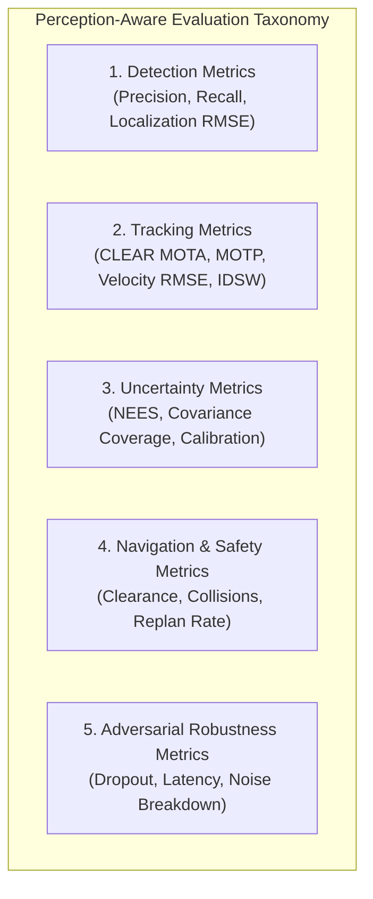

# ARL Phase V: Scientific Validation Plan & Experimental Protocol

## Executive Summary

Phase V evolves AdaptiveRL from omniscient simulation navigation to perception-aware autonomous flight. Because autonomous perception introduces stochastic uncertainties, measurement latency, clustering approximations, and tracking errors, a rigorous and reproducible scientific validation framework is essential.

This document establishes the **Phase V Scientific Validation Plan**:
1. Formal mathematical metric definitions across detection, tracking, uncertainty calibration, navigation, and robustness.
2. An authoritative ground-truth evaluation protocol enforcing strict isolation.
3. Standardized experimental scenarios (Scenarios P01 through P10).
4. Statistical significance protocols ($N \ge 10$ inferential threshold, Student's $t$ confidence intervals).
5. Provisional acceptance criteria and phase gates for Phases V.1 through V.6.

> [!NOTE]
> All quantitative performance targets specified herein are **PROVISIONAL TARGETS** established as engineering design goals. In accordance with Non-Negotiable Engineering Rules 8 and 9, they do not represent measured baseline data and must be verified empirically in subsequent phases.

---

## 1. Scientific Metric Definitions



### 1.1 Exteroceptive Detection Metrics
Evaluated frame-by-frame by matching instantaneous candidate detections against ground-truth obstacles within the sensor field of view (FOV):

1. **Detection Association:**
   A detection $j$ at $\hat{\mathbf{c}}_j$ matches ground-truth obstacle $i$ at $\mathbf{c}_i^*$ if:
   $$\|\hat{\mathbf{c}}_j - \mathbf{c}_i^*\|_2 \le d_{\text{match\_thresh}} = r_{\text{obs}, i} + 0.5\text{ m}$$
   Unmatched detections are False Positives ($FP$); unmatched ground-truth obstacles in FOV are False Negatives ($FN$); matched pairs are True Positives ($TP$).

2. **Precision & Recall:**
   $$\text{Precision} = \frac{TP}{TP + FP}, \quad \text{Recall} = \frac{TP}{TP + FN}$$

3. **Centroid Localization Error (RMSE):**
   $$\text{RMSE}_{\text{det}} = \sqrt{\frac{1}{TP} \sum_{k=1}^{TP} \|\hat{\mathbf{c}}_k - \mathbf{c}_k^*\|_2^2}$$

4. **Bounding Radius Error:**
   $$e_r = \frac{1}{TP} \sum_{k=1}^{TP} (\hat{r}_k - r_k^*)$$

---

### 1.2 Multi-Object Tracking (MOT) Metrics
Evaluated over continuous flight trajectories using the classical CLEAR MOT standard (Bernardin & Stiefelhagen, 2008):

1. **Multiple Object Tracking Accuracy (MOTA):**
   Accounts for all tracking errors (false positives, missed targets, and identity switches) normalized by total ground-truth target occurrences:
   $$\text{MOTA} = 1 - \frac{\sum_t (FN_t + FP_t + \text{IDSW}_t)}{\sum_t GT_t}$$
   where:
   - $FN_t$: Missed targets at time step $t$.
   - $FP_t$: Phantom / spurious tracks at time step $t$.
   - $\text{IDSW}_t$: Identity switches (a persistent target is assigned a different track ID).
   - $GT_t$: Number of ground-truth obstacles present in the arena at time step $t$.

2. **Multiple Object Tracking Precision (MOTP):**
   Measures the average spatial localization accuracy of successfully tracked targets:
   $$\text{MOTP} = \frac{\sum_{t, i} d(\mathbf{p}_{i, t}^*, \hat{\mathbf{p}}_{i, t})}{\sum_t |M_t|}$$
   where $d(\mathbf{p}_{i, t}^*, \hat{\mathbf{p}}_{i, t})$ is Euclidean distance and $|M_t|$ is the number of valid target-track matches at step $t$.

3. **Velocity Estimation RMSE:**
   $$\text{RMSE}_v = \sqrt{\frac{1}{\sum_t |M_t|} \sum_{t, i} \|\hat{\mathbf{v}}_{i, t} - \mathbf{v}_{i, t}^*\|_2^2}$$

4. **Track Continuity Metrics:**
   - **Mostly Tracked (MT):** Percentage of ground-truth trajectories tracked for $\ge 80\%$ of their lifespan.
   - **Mostly Lost (ML):** Percentage of ground-truth trajectories tracked for $< 20\%$ of their lifespan.
   - **Track Fragmentation:** Count of times an interrupted track re-acquires a target after coasting.

---

### 1.3 Uncertainty & Covariance Calibration Metrics
To ensure that the estimated covariance matrix $P(t)$ accurately reflects physical prediction dispersion rather than arbitrary values:

1. **Normalized Estimation Error Squared (NEES):**
   For a 3D position error $\tilde{\mathbf{p}}_k = \hat{\mathbf{p}}_k - \mathbf{p}_k^*$ and estimated position covariance $\Sigma_{p, k}$:
   $$\epsilon_{p, k} = \tilde{\mathbf{p}}_k^T \Sigma_{p, k}^{-1} \tilde{\mathbf{p}}_k$$
   Under linear Gaussian estimation assumptions, $\epsilon_{p, k}$ follows a Chi-squared distribution with 3 degrees of freedom ($\epsilon \sim \chi_3^2$).

2. **Average NEES ($\bar{\epsilon}_p$):**
   Averaged across $M$ independent Monte Carlo runs:
   $$\bar{\epsilon}_{p, k} = \frac{1}{M} \sum_{m=1}^M \epsilon_{p, k}^{(m)}$$
   The filter is statistically consistent if $\bar{\epsilon}_{p, k}$ lies within the theoretical $95\%$ acceptance bounds:
   $$\left[ \chi_3^2(0.025) / M, \; \chi_3^2(0.975) / M \right]$$
   - $\bar{\epsilon} \gg 3.0$: Filter is **overconfident** (true error exceeds covariance; danger of collision).
   - $\bar{\epsilon} \ll 3.0$: Filter is **underconfident** (covariance is overly inflated; path blocked unnecessarily).

3. **Empirical 95% Confidence Ellipsoid Containment:**
   Percentage of steps where the true obstacle center lies inside the estimated $k_{\sigma} = 3.0$ bounding sphere:
   $$\text{Coverage}_{3\sigma} = \frac{1}{N} \sum_{k=1}^N \mathbb{I}\left( \|\hat{\mathbf{p}}_k - \mathbf{p}_k^*\|_2 \le k_{\sigma} \sqrt{\lambda_{\max}(\Sigma_{p, k})} \right) \ge 0.98$$

---

### 1.4 Navigation, Safety & Mission Execution Metrics
Evaluated on closed-loop flight in the 6-DOF simulation environment:

1. **Authoritative Outcome Classification:**
   Mapped strictly to the 8 mutually exclusive outcomes from Phase III/IV:
   `COLLISION`, `BOUNDARY_BREACH`, `SUCCESS`, `CRASH_FAULT`, `RECOVERED_DEGRADED`, `BLOCKED_NO_PATH`, `TIMEOUT`, `MAX_STEPS`.

2. **Continuous Swept Clearance ($d_{\text{clearance}}$):**
   Evaluated analytically between quadrotor flight segments and moving obstacle envelopes (split at boundary reflection events).
   - Minimum Clearance: $d_{\min} = \min_{t} d_{\text{clearance}}(t)$.
   - Clearance Violation: $d_{\min} < r_{\text{vehicle}} = 0.25\text{ m}$.

3. **Receding-Horizon Replanning Frequency:**
   Number of dynamic replan events triggered per meter of flight path.

4. **Path Efficiency & Extra Distance:**
   $$\eta_{\text{path}} = \frac{L_{\text{optimal\_direct}}}{L_{\text{actual}}}$$

5. **Flight Control Stability:**
   - RMS attitude tilt error: $\text{RMS}(\theta_{\text{tilt}})$.
   - Maximum body angular rate: $\max \|\boldsymbol{\omega}\|$.
   - Actuator saturation ratio: Percentage of time motor thrusts are clamped to $[0, f_{\max}]$.

---

## 2. Standardized Experimental Scenarios (P01 – P10)

Ten standardized perception benchmark scenarios are defined to test the perception pipeline incrementally:

| Scenario ID | Name | Description | Key Focus Area |
| :--- | :--- | :--- | :--- |
| **P01** | `static_isolated_detection` | Single stationary sphere in clear arena. Quadrotor hovers at fixed range. | Detection precision, centroid error, clustering stability. |
| **P02** | `dynamic_linear_crossing` | Spherical intruder crosses flight path perpendicularly at $1.5\text{ m/s}$. | CV Kalman filter convergence, velocity RMSE, MOTA. |
| **P03** | `dynamic_oscillating_intruder` | Obstacle executing harmonic oscillation ($A=3.0\text{ m}, T=5.0\text{ s}$). | Tracking under continuous acceleration, NEES consistency. |
| **P04** | `boundary_bounce_reflection` | Obstacle reflecting off arena boundary walls at $2.0\text{ m/s}$. | Association recovery across sharp velocity sign inversion. |
| **P05** | `multi_obstacle_slalom` | 4 moving obstacles crossing staggered flight corridors simultaneously. | Multi-target data association, gating, identity switches (IDSW). |
| **P06** | `narrow_canyon_traversal` | Drone navigates through tight corridor between static walls. | Swept clearance under covariance inflation; false blockage checks. |
| **P07** | `sensor_blackout_coasting` | Sensor feed dropped for $1.0\text{ s}$ during dynamic obstacle crossing. | Track coasting, uncertainty expansion, fail-safe hover hold. |
| **P08** | `divergent_prediction_evasion` | Dynamic obstacle shifts velocity unexpectedly at $t=2.5\text{ s}$. | Online divergence detection, receding-horizon evasive replan. |
| **P09** | `heavy_sensor_noise_stress` | LiDAR range noise increased to $\sigma = 0.20\text{ m}$ ($6\times$ nominal). | Filter robustness, NEES calibration, false positive rejection. |
| **P10** | `dense_clutter_perception_flight`| Full autonomous mission: 3 sequential waypoints, 3 dynamic + 3 static obstacles. | End-to-end perception-aware navigation; zero ground truth. |

---

## 3. Ground-Truth Evaluation Harness Architecture

The evaluation harness operates as an isolated observer:

```python
@dataclass
class PerceptionStepRecord:
    timestamp: float
    drone_true_position: np.ndarray
    drone_est_position: np.ndarray
    true_obstacles: List[Dict[str, Any]]        # True IDs, positions, velocities
    raw_detections: List[ObstacleDetection3D]   # Instantaneous detections
    tracked_obstacles: List[TrackedObstacle3D]  # Active filter tracks with P
    min_physical_clearance: float
    is_collision: bool
    mission_state: str

class PerceptionEvaluationHarness:
    """Offline evaluator computing scientific perception and tracking metrics."""

    def __init__(self, match_distance_threshold: float = 1.0) -> None:
        self.match_threshold = match_distance_threshold
        self.records: List[PerceptionStepRecord] = []

    def log_step(self, record: PerceptionStepRecord) -> None:
        """Record simulation step for offline metric computation."""
        self.records.append(record)

    def compute_summary_report(self) -> Dict[str, Any]:
        """Compute full CLEAR MOT, NEES, and navigation metrics over episode."""
        ...
```

---

## 4. Statistical Rigor & Inferential Protocol

In accordance with Phase III/IV standards:
1. **Inferential Sample Size ($N \ge 10$):**
   - Full benchmark evaluations mandate $N \ge 10$ independent episodes across distinct, recorded seeds.
   - 95% Confidence Intervals are computed via Student's $t$-distribution:
     $$\text{CI}_{95} = \bar{x} \pm t_{0.025, N-1} \frac{s}{\sqrt{N}}$$
2. **Smoke Test Marker:**
   Runs with $N < 10$ are explicitly tagged `is_smoke_test = True`; inferential confidence intervals are suppressed to prevent misleading scientific conclusions.
3. **Deterministic Seed Scheduling:**
   Standard seed schedules (`seeds = [42, 43, 44, 45, 46, 47, 48, 49, 50, 51]`) ensure bit-exact reproducibility across platforms.

---

## 5. Provisional Phase Acceptance Criteria

The following quantitative targets are established as provisional engineering goals for each implementation phase:

| Phase | Milestone Name | Key Provisional Acceptance Criteria | Status |
| :--- | :--- | :--- | :--- |
| **Phase V.0** | Architecture & Specification | Complete specifications, 8 ADRs, validation plan, zero code regression | `CURRENT` |
| **Phase V.1** | Simulated Sensor Foundation | Ray casting throughput $> 50\text{ Hz}$; range noise matches target $\sigma \pm 10\%$; dropout model verified | `PROVISIONAL` |
| **Phase V.2** | 3D Obstacle Detection | Detection Precision $\ge 95\%$; Recall $\ge 90\%$; Centroid RMSE $< 0.15\text{ m}$ on isolated obstacles | `PROVISIONAL` |
| **Phase V.3** | Dynamic Obstacle Tracking | MOTA $\ge 0.85$; Velocity RMSE $< 0.25\text{ m/s}$; Zero ID switches on linear crossing; NEES within $95\%$ bounds | `PROVISIONAL` |
| **Phase V.4** | Sensor Fusion & Extrinsics | Projected point cloud spatial error $< 0.05\text{ m}$ under $30^\circ/\text{s}$ vehicle yaw rate | `PROVISIONAL` |
| **Phase V.5** | Perception-Aware Navigation | Success Rate $\ge 90\%$ on Scenarios P01–P06; Zero ground-truth leakage; Minimum clearance $> 0.20\text{ m}$ | `PROVISIONAL` |
| **Phase V.6** | Adversarial Validation | $100\%$ fail-safe hover hold on sensor blackout; Success $\ge 85\%$ across full 10-scenario suite ($N \ge 10$) | `PROVISIONAL` |
